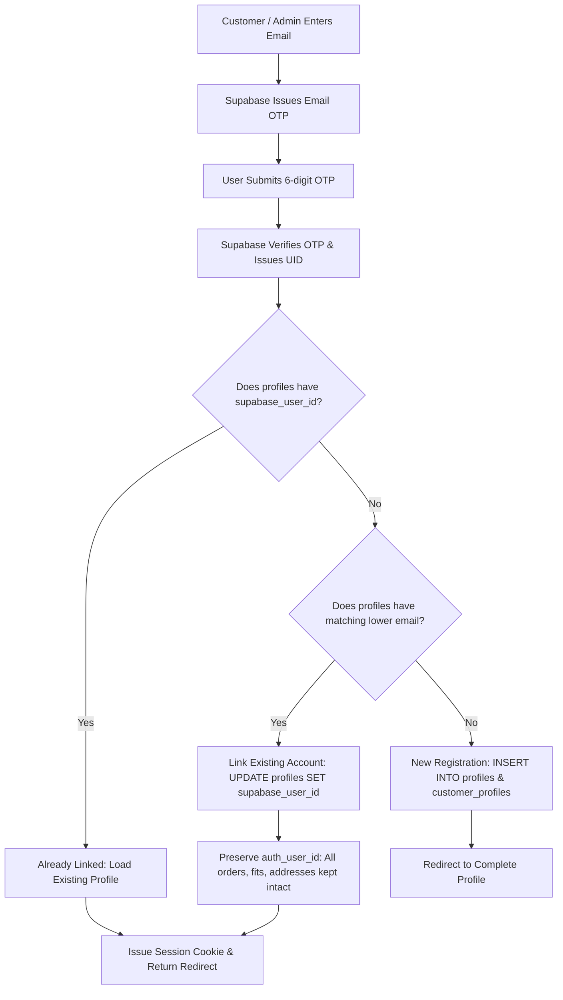

# VISHREA STUDIO — Existing Account Migration Plan

## 1. Existing Account Inventory

The VISHREA STUDIO database contains existing records whose data, orders, and permissions must be strictly preserved:

### Existing Live Administrator Accounts:
1. `owner@vishrea.test` (`usr_c1bbbdd62eb143e1958541ce6868cea5`) — Role: `admin` (Owner)
2. `intellibytevaishal@gmail.com` (`usr_c1fa52ef56954909a7150db447dde20d`) — Role: `admin`
3. `vishreastudio.admin@gmail.com` (`usr_06dd03e3e48d4a8f930445dcaf8587ab`) — Role: `admin`
4. `admin@vishrea.com` (`vishrea-admin-01`) — Role: `admin`

### Existing Customer Accounts:
1. `kavya01@gmail.com` (`usr_08f577d03d2b46b0a43384292872152b`)
2. `mdvaishal15@gmail.com` (`usr_573c7bb0a48a45d695139e4c3e72a383`)
3. `vaishalmaluk@gmail.com` (`usr_e350912219c546c3814406753651531f`)
4. `luckyboyvaishal@gmail.com` (`usr_5084b742a8d04371b1f3352261c71515`)

---

## 2. Migration Strategy: Non-Destructive Lazy Account Linking

Rather than running a risky batch migration that creates artificial Supabase users in advance, the architecture uses **zero-downtime lazy account linking**:



### Why Lazy Linking is Safest:
1. **Preserves Primary Identity Anchor**: All tables (`orders`, `addresses`, `customer_size_profiles`, `wardrobe_items`, `memberships`, `credit_ledger`) reference `auth_user_id`. Because `auth_user_id` is never changed during linking, **zero historical records are orphaned**.
2. **Zero Production Downtime**: Customers log in with their existing email address and are linked instantly on their next sign-in.
3. **No Credential Inconsistencies**: No batch scripts needing passwords or mock tokens are run against Supabase Auth.

---

## 3. Account Linking Procedure

### Step-by-Step Flow:
1. **Initiation**: Customer or administrator enters their existing email into the storefront sign-in form.
2. **OTP Dispatch**: Supabase sends the 6-digit verification code via Custom SMTP (Resend).
3. **OTP Submission**: The user enters the code.
4. **Backend Resolution**:
   - The backend checks `SELECT * FROM profiles WHERE lower(email) = lower($email)`.
   - The existing row is found.
   - The backend links the Supabase UID:
     ```sql
     UPDATE profiles
     SET supabase_user_id = $supabase_uid,
         updated_at = now()
     WHERE id = $profile_id;
     ```
   - For administrators, `isAdminRow()` confirms their existing admin status and allowlist membership.
   - For customers, their existing `customer_profiles` data, personalized size profiles, and wardrobe items are preserved.

---

## 4. Owner Intervention Guidelines

If an existing customer or administrator requires manual identity verification or account reconciliation:

1. **Verify Customer Identity**:
   Confirm the customer's identity and primary email address.
2. **Check Database Association**:
   ```sql
   SELECT auth_user_id, supabase_user_id, email, full_name, role, is_admin
   FROM profiles
   WHERE lower(email) = 'target_email@example.com';
   ```
3. **Unlink / Reset Supabase Identity (if needed)**:
   If a customer changed their Supabase account or need re-linking:
   ```sql
   UPDATE profiles
   SET supabase_user_id = NULL, updated_at = now()
   WHERE auth_user_id = 'usr_target_id';
   ```
   The next login with that email will re-link to the new Supabase UID automatically.

---

## 5. Rollback Plan

If a rollback of the Supabase integration is required:

1. **Database Rollback**:
   The migration is non-destructive. If necessary, remove the index and column:
   ```sql
   DROP INDEX IF EXISTS idx_profiles_supabase_user_id;
   DROP INDEX IF EXISTS idx_profiles_email_lower;
   ALTER TABLE profiles DROP COLUMN IF EXISTS supabase_user_id;
   DELETE FROM _schema_migrations WHERE filename = '030_supabase_auth_integration.sql';
   ```
2. **Code Rollback**:
   Revert `api/auth.js`, `lib/auth.js`, and `vishrea-react/src/context/StoreContext.jsx` to resume using direct Resend OTP dispatch.
3. **Data Integrity Assurance**:
   Because `auth_user_id` was never modified, all customer orders, measurements, addresses, and admin permissions remain intact throughout any rollback.
