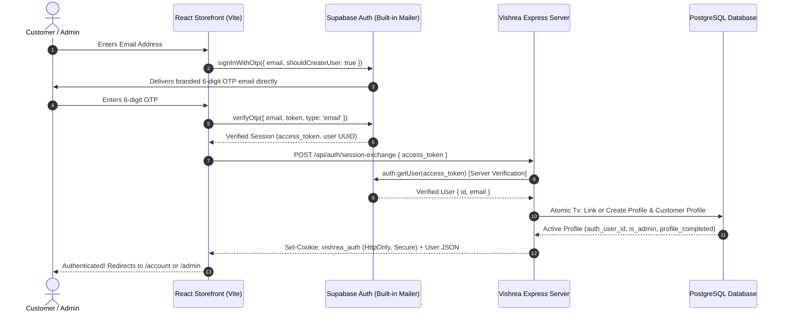
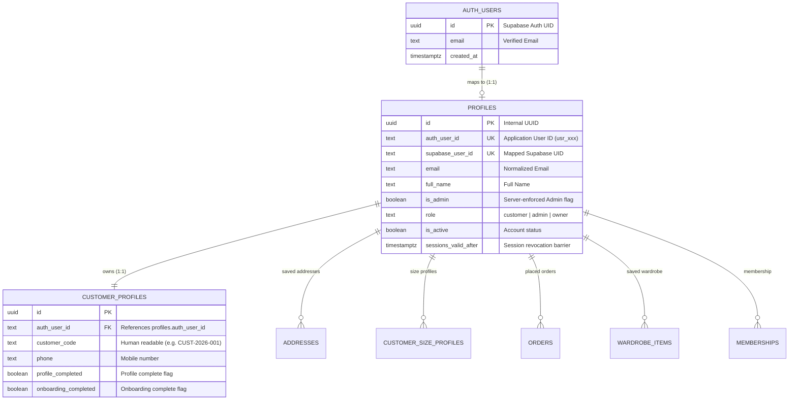

# VISHREA STUDIO — Supabase Authentication Architecture

## 1. Architectural Overview & Design Philosophy

VISHREA STUDIO uses a hybrid authentication model designed for maximum security, zero-trust backend authorization, and seamless customer experience:
- **Supabase Authentication** serves as the managed identity provider (IdP) for passwordless Email OTP generation, token verification, and email delivery via Resend SMTP.
- **Express Backend & PostgreSQL** remain the authoritative single source of truth for customer authorization, admin roles, session validation, profile data, order history, and business rules.
- **Session Exchange Architecture**: After verifying a passwordless email OTP with Supabase, the client exchanges the Supabase access token with the Express server. The server cryptographically validates the token against the Supabase Auth server, links or initializes the customer record in PostgreSQL, and issues a secure, HTTP-only, `SameSite=Lax` session cookie (`vishrea_auth`).
- **Unified Identity**: We do not run two conflicting authentication systems. Supabase identity (`supabase_user_id` UUID) maps directly to the existing internal customer identity (`auth_user_id`). All historical orders, addresses, personalized size profiles, fit preferences, credits, and memberships continue to reference `auth_user_id`.

---

## 2. Component Responsibilities

| Component | Responsibility | Boundary & Constraints |
| :--- | :--- | :--- |
| **Storefront (React 19 + Vite)** | Collects email, drives OTP UI with timer, interacts with `@supabase/supabase-js` client, passes Supabase access token to Express backend. | Never holds `SUPABASE_SERVICE_ROLE_KEY`. Only uses `VITE_SUPABASE_URL` and `VITE_SUPABASE_ANON_KEY`. |
| **Supabase Auth Service** | Issues 6-digit OTP codes, enforces OTP time-to-live (TTL), throttles rate limits, and sends branded emails directly via Supabase's built-in mailer. | Does not store customer business attributes (e.g. measurements, orders, credits). Does not require external SMTP or Resend API. |
| **Express Backend** | Server-side cryptographic token verification (`getUser`), session exchange, issuing `vishrea_auth` HTTP-only cookie, enforcing admin authorization, session revocation. | Never trusts frontend user metadata, role flags, or customer IDs. |
| **PostgreSQL Database** | Stores `profiles`, `customer_profiles`, `addresses`, `customer_size_profiles`, `orders`, `memberships`. | Maintains non-destructive link between `profiles.supabase_user_id` and `profiles.auth_user_id`. |

---

## 3. Customer Identity Mapping Architecture

### Entity Relationship Model

### Resolution Rules:
1. **Existing User by Supabase UID**: If `profiles.supabase_user_id = $supabase_uid` exists, return immediately.
2. **Existing User by Email (Lazy Account Linking)**: If not matched by Supabase UID, query `profiles WHERE lower(email) = lower($email)`. If found, execute `UPDATE profiles SET supabase_user_id = $supabase_uid, updated_at = now() WHERE id = $id`. This seamlessly links existing customers and existing admins without altering their `auth_user_id`, orders, or permissions.
3. **New Customer Creation**: If no profile matches by Supabase UID or email:
   - Generate unique `auth_user_id = 'usr_' || replace(gen_random_uuid()::text, '-', '')`.
   - Insert into `profiles` with `role = 'customer'`, `is_admin = false`, and `supabase_user_id = $supabase_uid`.
   - Generate `customer_code = await nextHumanId(c, ID_PREFIXES.CUSTOMER)` (e.g., `CUST-2026-009`).
   - Insert into `customer_profiles` with `profile_completed = false`.
   - **Crucial Rule**: Do not create memberships, credits, rewards, or orders automatically.

---

## 4. Session & Cookie Security Architecture

1. **Token Verification**:
   - Signature, issuer (`https://<project-ref>.supabase.co/auth/v1`), audience (`authenticated`), and expiry (`exp > now`) are validated.
   - Verified directly against Supabase Auth service via `auth.getUser(access_token)`.
2. **Session Cookie**:
   - Cookie name: `vishrea_auth`.
   - Flags: `HttpOnly: true`, `SameSite: 'lax'`, `Path: '/'`, `Secure: true` in production.
   - Max age: `config.sessionDays` (14 days).
3. **Session Revocation**:
   - Every profile has a `sessions_valid_after` timestamp.
   - On logout (`POST /api/auth/signout`), the server executes:
     `UPDATE profiles SET sessions_valid_after = GREATEST(now(), to_timestamp($issuedAt + 1)) WHERE auth_user_id = $uid`.
   - Any token issued at or before this timestamp is rejected immediately on subsequent requests.

---

## 5. Admin Authentication Architecture

- **Preservation of the 4 Live Admin Accounts**:
  1. `owner@vishrea.test` (`usr_c1bbbdd62eb143e1958541ce6868cea5`)
  2. `intellibytevaishal@gmail.com` (`usr_c1fa52ef56954909a7150db447dde20d`)
  3. `vishreastudio.admin@gmail.com` (`usr_06dd03e3e48d4a8f930445dcaf8587ab`)
  4. `admin@vishrea.com` (`vishrea-admin-01`)
- **Zero-Trust Admin Authorization**:
  - Admin access is never determined by client metadata, JWT claims, or email heuristics.
  - The Express middleware verifies:
    1. The profile row in PostgreSQL has `is_admin = true` or `role IN ('admin', 'owner')`.
    2. The email matches the owner-configured `ADMIN_ALLOWED_EMAILS` allowlist.
    3. `is_active` is not false.
  - New customer registrations are strictly restricted to `role = 'customer'` and `is_admin = false`.
