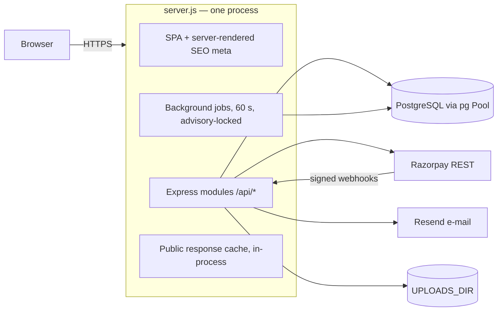

# Master Architecture Audit

| Field | Value |
|---|---|
| Date | 7 November 2026 |
| Scope | Whole repository: `server.js`, `api/`, `lib/`, `migrations/`, `vishrea-react/`, `scripts/`, `test/` |
| Method | Code reading, running the app (dev and production build), browser network capture, test suite, load test on a local database |
| Related | [PERFORMANCE_AUDIT](PERFORMANCE_AUDIT.md) · [API_OPTIMIZATION](API_OPTIMIZATION.md) · [DATABASE_OPTIMIZATION](DATABASE_OPTIMIZATION.md) · [SCALABILITY_ASSESSMENT](SCALABILITY_ASSESSMENT.md) · [SECURITY_REVIEW](SECURITY_REVIEW.md) · [technical/TECHNICAL_ARCHITECTURE](technical/TECHNICAL_ARCHITECTURE.md) |

## 1. Existing architecture

A **modular monolith**: one Node.js process (`server.js`) serves the built React SPA, the REST API, uploads and the background jobs. It was retained unchanged in shape; no service was split out and no infrastructure was added.

## 2. Actual technology stack (inspected, not assumed)

| Layer | Technology | Evidence |
|---|---|---|
| Runtime | Node.js ≥ 20 (v24.18 locally), ES modules | `package.json` |
| HTTP | Express 4, `cookie-parser`, `cors` | `server.js` |
| Database | PostgreSQL via `pg` Pool; Supabase used only as a Postgres host (staging) | `lib/db.js`, `.env` host `db.<ref>.supabase.co` |
| Auth | Email OTP → HS256 JWT in an `HttpOnly; SameSite=Lax` cookie; role re-read from DB on every request | `lib/auth.js`, `api/auth.js` |
| Payments | Razorpay Orders, Subscriptions (UPI Autopay), signed webhooks | `lib/razorpay.js`, `api/webhooks/razorpay.js`, `lib/billing.js` |
| E-mail | Resend HTTP API | `lib/notify.js` |
| Front end | React 19, React Router 7, Vite 8, plain CSS; no data-fetching library | `vishrea-react/package.json` |
| Tests | `node:test`, real Postgres, in-process Razorpay stand-in | `test/` |
| Not present | Redis, queues, CDN configuration, Docker/compose for the app, reverse-proxy config | repository search |

## 3. Modules and ownership

| Responsibility | API module(s) | Library | Tables (main) |
|---|---|---|---|
| Authentication & authorization | `api/auth.js`, central `mountModule` access check | `lib/auth.js`, `lib/http.js` (origin guard) | `profiles`, `auth_otps` |
| Customers | `api/account.js` | — | `customer_profiles`, `addresses`, `wearer_profiles` |
| Products & catalogue | `api/catalogue.js`, `api/product.js` | `lib/catalogue.js`, `lib/products-admin.js`, `lib/public-cache.js` | `products`, `product_variants`, `categories`, `drop_settings` |
| Inventory & stock | (internal) | `lib/inventory.js` | `product_variants.stock_quantity`, `inventory_reservations`, `inventory` |
| Bag / Wardrobe Bag | `api/cart.js`, `api/wardrobe.js` | `lib/cart.js`, `lib/bag.js` | `carts`, `cart_items`, `bag_shipments` |
| Orders & checkout | `api/checkout.js`, `api/orders.js`, `api/payment-verify.js`, `api/exchange.js` | `lib/payments.js`, `lib/pricing.js` | `orders`, `order_items`, `invoice_records`, `exchanges` |
| Payments & webhooks | `api/webhooks/razorpay.js` | `lib/razorpay.js`, `lib/payments.js` | `payment_events`, `membership_payments` |
| Membership & billing | `api/membership.js` | `lib/membership.js`, `lib/billing.js`, `lib/credits.js` | `memberships`, `membership_periods`, `membership_subscriptions`, `credit_ledger` |
| Loyalty, rewards, referrals | `api/referrals.js` | `lib/rewards.js`, `lib/referrals.js` | `reward_entitlements`, `referrals` |
| Gift memberships | `api/gifting.js` | `lib/gifts.js` | `admin_gift_enquiries`, `gift_memberships` |
| **Shipping & couriers (new)** | `api/admin/ops.js` sections `couriers`, `courier`, `courier_status`, `order_shipments` | `lib/couriers.js` | `couriers`, `order_shipment_events`, `orders.courier_id/tracking_url` |
| Notifications | — | `lib/notify.js` | `notifications` |
| Admin & reporting | `api/admin/ops.js`, `api/admin/listing-studio.js` | `lib/settings-admin.js` | `audit_logs`, `app_settings` |

**Module communication.** API modules call library functions; libraries call each other only downward (`inventory → db/settings/public-cache`, `couriers → validate/http/audit`). No circular imports were found. The one cross-boundary import (the admin API importing `vishrea-react/src/lib/couriers.js`) was removed; the server now owns courier logic in `lib/couriers.js`. Server-rendered SEO still deliberately shares pure modules (`site.config.js`, `lib/pages.js`, `lib/schema.js`, `lib/productCopy.js`, `content/*`) with the SPA.

**Cross-cutting, already central:** error handling (`errorHandler`, `AppError` → `{ error, message, request_id }`), validation (`lib/validate.js`), access control (`access`/`methods` per module), rate limiting (`lib/rate-limit.js`), audit (`lib/audit.js`), structured logs with secret scrubbing (`lib/log.js`), transactions (`db.tx`).

## 4. API architecture

Action-style REST: one module per domain, `GET` for reads and `POST {action}` / `PUT` / `PATCH` / `DELETE` for writes. Admin is one module (`/api/admin/ops?section=…`). Responses are JSON; errors are uniform. Full list: [technical/API_DOCUMENTATION](technical/API_DOCUMENTATION.md).

## 5. Database architecture

PostgreSQL, 21 ordered SQL migrations (`scripts/migrate.js`, recorded in `_schema_migrations`). Money is `NUMERIC(12,2)`; invariants are enforced by constraints and partial unique indexes (one open checkout per idempotency key, one webhook per event id, one reservation per order line, etc.). RLS is enabled on hosted Postgres as defence-in-depth; the app connects as owner. Details: [DATABASE_OPTIMIZATION](DATABASE_OPTIMIZATION.md).

## 6. Authentication flow

`POST /api/auth/start-login` (OTP, HMAC-hashed, 10 min, 5 attempts, resend throttled) → `POST /api/auth/verify-code` (atomic attempt count, single-use delete) → JWT cookie. Every API request resolves the user from the database (`profiles`), so role changes and sign-out (`sessions_valid_after`) take effect immediately. Admin requires an admin role **and**, when set, `ADMIN_ALLOWED_EMAILS`.

## 7. Payment flow

Order: `POST /api/checkout` (transaction: re-price from DB, take stock with a conditional update, hold reservations, create a Razorpay order) → Razorpay Checkout → `POST /api/payment-verify` (HMAC + gateway fetch + amount match) **or** signed webhook → idempotent finalisation (reservation commit, invoice). Expired holds are released by the sweep; a late payment re-acquires stock or is refunded. Membership: upfront months plus a UPI Autopay mandate in one checkout; monthly debits by webhook. See [technical/TECHNICAL_ARCHITECTURE](technical/TECHNICAL_ARCHITECTURE.md) §4–5.

## 8. Hosting and deployment

Self-hosted Node process (`start.sh` / `start.ps1`). No reverse proxy, CDN or container configuration exists in the repository. Staging database: Supabase Postgres (direct connection). Uploads: local directory. Implications are in [SCALABILITY_ASSESSMENT](SCALABILITY_ASSESSMENT.md).

## 9. Bottlenecks found (measured)

| # | Finding | Evidence | Status |
|---|---|---|---|
| B1 | Dev API restarted on every frontend/test/scratch edit (nodemon watched the whole repo) → homepage calls failed with `ECONNREFUSED` | Vite log, nodemon log | **Fixed** (`nodemon.json`) |
| B2 | Each homepage API call sent twice in dev, first one cancelled (StrictMode remount + abort-on-unmount); session and bag fetched twice | Browser resource timing: 8 API calls / 2 cancelled | **Fixed** (shared GET layer) |
| B3 | JS/CSS sent uncompressed (no proxy compresses them) | 424 KB on the wire for 3 files | **Fixed** (build-time Brotli/gzip, −74 %) |
| B4 | Throughput capped by the 10-connection pool: identical public queries repeated per request | 500 VUs: 640 req/s, p95 1.46 s, up to 973 waiting for a connection | **Fixed** (in-process public cache) — see load report |
| B5 | Catalogue and product endpoints ran independent queries one after another | Code | **Fixed** (parallel) |
| B6 | Suspected missing index for reservation lookups by order | EXPLAIN ANALYZE: the unique `(order_id, variant_id)` index already serves them (0.02–0.04 ms) | **Not a problem** — a draft index was withdrawn |

## 10. Security concerns

See [SECURITY_REVIEW](SECURITY_REVIEW.md). Notable: anonymous uploads (closed), tracked `.env` files with live-looking keys in the working tree (outside git — verify), in-memory rate limiter is per instance.

## 11. Scalability limitations

Single process; in-memory rate limiter and public cache are per instance; uploads on local disk; background jobs now lock-guarded for multiple instances. See [SCALABILITY_ASSESSMENT](SCALABILITY_ASSESSMENT.md).

## 12. Recommended changes (not done, need a decision or infrastructure)

1. Put a TLS reverse proxy/CDN (Cloudflare, Nginx) in front for HTTP/2, edge caching of `/assets/*` and images, and compression of API JSON.
2. Before running more than one instance: move rate limiting to a shared store, uploads to object storage, and size `DB_POOL_MAX × instances` within the database's connection limit (Supabase pooler in session mode).
3. Serve product images in WebP/AVIF at fixed widths (needs an image pipeline, e.g. `sharp` at upload time) — not added, to avoid a native dependency without approval.
4. Decide whether to drop the retained `piece_requests` table (data deletion — owner approval required).
