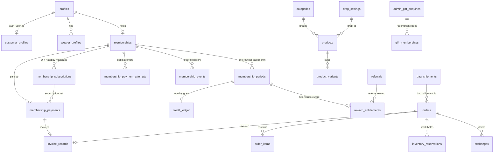

# Database Schema

| Field | Value |
|---|---|
| Document ID | VS-DB-001 |
| Document title | Database Schema |
| Version | 1.0 |
| Status | Current — generated from the live staging catalogue |
| Prepared date | 7 November 2026 |
| Last updated | 7 November 2026 |
| Source of truth | `migrations/001…020` as applied to the staging database (20 of 20 applied); §5 is generated from `pg_catalog` / `information_schema` |

Related: [Technical Architecture](TECHNICAL_ARCHITECTURE.md) · [API Documentation](API_DOCUMENTATION.md) · [Security Audit](SECURITY_AUDIT.md)

## 1. Overview

- **Engine:** PostgreSQL (Supabase-hosted for staging; any PostgreSQL 14+ works). The application uses the `pg` driver directly; it does **not** use Supabase Auth, Supabase Storage or PostgREST.
- **Access model:** only the Express server connects, as the table owner. Migration 013 enables row-level security on every public table and revokes all privileges from Supabase's `anon` and `authenticated` roles. Verified on staging on 7 Nov 2026: 0 tables without RLS, 0 tables readable by `anon`/`authenticated`.
- **Schema changes:** `npm run migrate` (`scripts/migrate.js`) applies every `migrations/*.sql` file not yet recorded in `_schema_migrations`, one transaction per file. All migrations are written to be forward-only and re-runnable.
- **Money** is `numeric(12,2)` in rupees; gateway amounts are integer paise (`amount_paise`).
- **Settings** are rows in `app_settings` (`key`, `jsonb value`), typed and validated by `lib/settings.js` (`SETTING_META`).

Tables present on staging: **56** (including `_schema_migrations`). A few legacy tables are still present but unused by current code (`gifts`, `offers`, `payment_locks`, `inventory`'s `reserved_until`); see [Gap Analysis](../client/GAP_ANALYSIS.md) item P2-08.

## 2. Domain map

| Domain | Tables |
|---|---|
| Identity | `profiles`, `auth_otps`, `customer_profiles`, `wearer_profiles`, `addresses`, `notification_preferences` |
| Catalogue & stock | `categories`, `products`, `product_variants`, `product_photos`, `inventory`, `inventory_reservations`, `drop_settings`, `sourcing_batches`, `product_sources` |
| Cart & orders | `carts`, `cart_items`, `wardrobe_items`, `orders`, `order_items`, `store_sales`, `bag_shipments`, `invoice_records`, `exchanges` |
| Payments | `payment_events` (webhook idempotency), `membership_payments`, `membership_payment_attempts`, `billing_plans`, `membership_subscriptions` |
| Membership & credits | `memberships`, `membership_periods`, `membership_events`, `credit_ledger` |
| Rewards & referrals | `reward_entitlements`, `referrals`, `loyalty_rules`, `loyalty_events`, `pricing_rules` |
| Gifting | `admin_gift_enquiries`, `gift_memberships` |
| Content & AI | `colour_reviews`, `saved_looks`, `saved_look_items`, `instagram_content`, `feedback_videos`, `story_consents`, `legal_pages`, `store_settings`, `piece_requests` |
| Operations | `app_settings`, `audit_logs`, `notifications`, `_schema_migrations` |

## 3. Key relationships

Several relationships are enforced by application code rather than foreign keys (most `auth_user_id` columns are `text` without a foreign key, inherited from early migrations). See §5 for the foreign keys that exist.

## 4. Migration history

| File | Purpose |
|---|---|
| 001–004 | Initial profiles, catalogue, commerce, product content |
| 005–007 | V1 catalogue/demo seed and inventory seed |
| 008 | Operations tables (colour reviews, videos, Instagram, gifts, offers, referrals, store settings) |
| 009 | Colour analysis v1 |
| 010 | Production v1: settings, audit log, credit ledger, membership payments, invoices, drops, loyalty/pricing rules, sourcing, saved looks, legal pages |
| 011 | Membership payment columns (autopay id, consecutive months, pause) |
| 012 | Piece requests (with its own RLS policies). Feature removed 7 Nov 2026; the table and its data are retained, unused by the application |
| 013 | Production hardening: variants, reservations, OTPs, payment events, constraints, invoice numbering, RLS lockdown for Supabase roles |
| 014 | Order tracking |
| 015 | Credit and video caps |
| 016 | Payment reconciliation |
| 017 | Membership lifecycle (periods), reward entitlements, referral attribution, gift enquiries and codes, typed settings |
| 018 | 6th-month rule → consecutive paid months; renewal grace; referral backfill |
| 019 | Billing engine: mandates, debit attempts, membership events, Wardrobe Bag shipments, online gifts, notifications log, new settings |
| 020 | RLS enabled on every public table and Supabase roles revoked again (covers tables created after 013); no-op on plain PostgreSQL |
| 021 | Courier registry (`couriers`, seeded with the 7 previous fixed couriers), `orders.courier_id` + `orders.tracking_url` (backfilled), `order_shipment_events` history; drops the fixed-name `orders_courier_partner_valid` check. **Not yet applied to staging** |

Rehearsal: `test/migration-rehearsal.test.js` applies 015–021 to a live-shaped legacy schema (including a pre-021 dispatched order) and re-runs them; every integration test run applies 001–021 to an empty database. The generated table reference below predates 021; see [DATABASE_OPTIMIZATION.md](../DATABASE_OPTIMIZATION.md) and [COURIER_MANAGEMENT.md](../COURIER_MANAGEMENT.md) for the new tables.

## 5. Table reference (generated)

Generated on 7 Nov 2026 from the staging database catalogue. Column defaults are truncated.

### `_schema_migrations`

Row-level security: enabled.

| Column | Type | Null | Default |
|---|---|---|---|
| `id` | integer | no | nextval('_schema_migrations_id_seq'::regclass) |
| `filename` | text | no |  |
| `applied_at` | timestamp with time zone | yes | now() |

Constraints:

- `_schema_migrations_pkey` (primary key): PRIMARY KEY (id)
- `_schema_migrations_filename_key` (unique): UNIQUE (filename)

### `addresses`

Row-level security: enabled.

| Column | Type | Null | Default |
|---|---|---|---|
| `id` | uuid | no | gen_random_uuid() |
| `auth_user_id` | text | no |  |
| `label` | text | yes | 'Home'::text |
| `recipient_name` | text | yes |  |
| `phone` | text | yes |  |
| `line1` | text | yes |  |
| `line2` | text | yes |  |
| `city` | text | yes |  |
| `state` | text | yes |  |
| `pincode` | text | yes |  |
| `is_default` | boolean | yes | false |
| `created_at` | timestamp with time zone | yes | now() |
| `updated_at` | timestamp with time zone | yes | now() |

Constraints:

- `addresses_pkey` (primary key): PRIMARY KEY (id)

Indexes:

- `idx_addresses_user`: (auth_user_id)

### `admin_gift_enquiries`

Row-level security: enabled.

| Column | Type | Null | Default |
|---|---|---|---|
| `id` | uuid | no | gen_random_uuid() |
| `enquiry_number` | text | no | ('GE-'::text \|\| nextval('gift_enquiry_number_seq… |
| `submitted_by` | text | yes |  |
| `request_type` | text | no | 'individual'::text |
| `sender_name` | text | no |  |
| `sender_email` | text | no |  |
| `sender_phone` | text | no |  |
| `company_name` | text | yes |  |
| `recipient_name` | text | yes |  |
| `recipient_email` | text | yes |  |
| `recipient_phone` | text | yes |  |
| `membership_months` | integer | no |  |
| `quantity` | integer | no | 1 |
| `message` | text | yes |  |
| `status` | text | no | 'pending'::text |
| `admin_notes` | text | yes |  |
| `invoice_reference` | text | yes |  |
| `invoice_amount` | numeric | yes |  |
| `status_changed_by` | text | yes |  |
| `status_changed_at` | timestamp with time zone | yes |  |
| `processed_at` | timestamp with time zone | yes |  |
| `invoiced_at` | timestamp with time zone | yes |  |
| `submission_key` | text | yes |  |
| `created_at` | timestamp with time zone | no | now() |
| `updated_at` | timestamp with time zone | no | now() |
| `source` | text | no | 'enquiry'::text |
| `gift_mode` | text | yes |  |
| `start_date` | date | yes |  |
| `wearer_id` | uuid | yes |  |
| `amount` | numeric | yes |  |
| `razorpay_order_id` | text | yes |  |
| `provider_payment_id` | text | yes |  |
| `paid_at` | timestamp with time zone | yes |  |

Constraints:

- `admin_gift_enquiries_invoice_amount_check` (check): CHECK (((invoice_amount IS NULL) OR (invoice_amount >= (0)::numeric)))
- `admin_gift_enquiries_membership_months_check` (check): CHECK (((membership_months >= 1) AND (membership_months <= 24)))
- `admin_gift_enquiries_quantity_check` (check): CHECK (((quantity >= 1) AND (quantity <= 100)))
- `admin_gift_enquiries_request_type_check` (check): CHECK ((request_type = ANY (ARRAY['individual'::text, 'corporate'::text])))
- `admin_gift_enquiries_status_check` (check): CHECK ((status = ANY (ARRAY['pending'::text, 'processed'::text, 'invoiced'::text])))
- `gift_enquiries_mode_valid` (check): CHECK (((gift_mode IS NULL) OR (gift_mode = ANY (ARRAY['gift_to_her'::text, 'pick_for_her'::text])))) NOT VALID
- `gift_enquiries_source_valid` (check): CHECK ((source = ANY (ARRAY['enquiry'::text, 'online'::text]))) NOT VALID
- `admin_gift_enquiries_pkey` (primary key): PRIMARY KEY (id)
- `admin_gift_enquiries_enquiry_number_key` (unique): UNIQUE (enquiry_number)

Indexes:

- `idx_gift_enquiries_sender`: (lower(sender_email), created_at DESC)
- `idx_gift_enquiries_status`: (status, created_at DESC)
- `uq_gift_enquiries_payment`: UNIQUE (provider_payment_id) WHERE (provider_payment_id IS NOT NULL)
- `uq_gift_enquiries_rzp_order`: UNIQUE (razorpay_order_id) WHERE (razorpay_order_id IS NOT NULL)
- `uq_gift_enquiries_submission`: UNIQUE (submission_key) WHERE (submission_key IS NOT NULL)

### `app_settings`

Row-level security: enabled.

| Column | Type | Null | Default |
|---|---|---|---|
| `key` | text | no |  |
| `value` | jsonb | no | '{}'::jsonb |
| `updated_at` | timestamp with time zone | yes | now() |

Constraints:

- `app_settings_pkey` (primary key): PRIMARY KEY (key)

### `audit_logs`

Row-level security: enabled.

| Column | Type | Null | Default |
|---|---|---|---|
| `id` | uuid | no | gen_random_uuid() |
| `auth_user_id` | text | yes |  |
| `action` | text | no |  |
| `entity_type` | text | yes |  |
| `entity_id` | text | yes |  |
| `details` | jsonb | yes | '{}'::jsonb |
| `created_at` | timestamp with time zone | yes | now() |

Constraints:

- `audit_logs_pkey` (primary key): PRIMARY KEY (id)

Indexes:

- `idx_audit_logs_created`: (created_at DESC)
- `idx_audit_logs_entity`: (entity_type, entity_id)

### `auth_otps`

Row-level security: enabled.

| Column | Type | Null | Default |
|---|---|---|---|
| `email` | text | no |  |
| `code_hash` | text | no |  |
| `expires_at` | timestamp with time zone | no |  |
| `attempts` | integer | no | 0 |
| `send_count` | integer | no | 1 |
| `window_started_at` | timestamp with time zone | no | now() |
| `last_sent_at` | timestamp with time zone | no | now() |

Constraints:

- `auth_otps_pkey` (primary key): PRIMARY KEY (email)

### `bag_shipments`

Row-level security: enabled.

| Column | Type | Null | Default |
|---|---|---|---|
| `id` | uuid | no | gen_random_uuid() |
| `auth_user_id` | text | no |  |
| `status` | text | no | 'pending_payment'::text |
| `shipping_method` | text | no |  |
| `shipping_address` | jsonb | no |  |
| `order_ids` | ARRAY | no |  |
| `pieces` | integer | no |  |
| `shipping_fee` | numeric | no | 0 |
| `amount_paise` | integer | no | 0 |
| `razorpay_order_id` | text | yes |  |
| `provider_payment_id` | text | yes |  |
| `payment_expires_at` | timestamp with time zone | yes |  |
| `paid_at` | timestamp with time zone | yes |  |
| `idempotency_key` | text | yes |  |
| `created_at` | timestamp with time zone | no | now() |
| `updated_at` | timestamp with time zone | no | now() |

Constraints:

- `bag_shipments_amount_paise_check` (check): CHECK ((amount_paise >= 0))
- `bag_shipments_pieces_check` (check): CHECK ((pieces > 0))
- `bag_shipments_shipping_fee_check` (check): CHECK ((shipping_fee >= (0)::numeric))
- `bag_shipments_shipping_method_check` (check): CHECK ((shipping_method = ANY (ARRAY['delivery'::text, 'pickup'::text])))
- `bag_shipments_status_check` (check): CHECK ((status = ANY (ARRAY['pending_payment'::text, 'paid'::text, 'cancelled'::text, 'expired'::text])))
- `bag_shipments_pkey` (primary key): PRIMARY KEY (id)
- `bag_shipments_provider_payment_id_key` (unique): UNIQUE (provider_payment_id)
- `bag_shipments_razorpay_order_id_key` (unique): UNIQUE (razorpay_order_id)

Indexes:

- `uq_bag_shipments_idem`: UNIQUE (auth_user_id, idempotency_key) WHERE (idempotency_key IS NOT NULL)
- `uq_bag_shipments_open`: UNIQUE (auth_user_id) WHERE (status = 'pending_payment'::text)

### `billing_plans`

Row-level security: enabled.

| Column | Type | Null | Default |
|---|---|---|---|
| `amount_paise` | integer | no |  |
| `razorpay_plan_id` | text | no |  |
| `created_at` | timestamp with time zone | no | now() |

Constraints:

- `billing_plans_amount_paise_check` (check): CHECK ((amount_paise > 0))
- `billing_plans_pkey` (primary key): PRIMARY KEY (amount_paise)
- `billing_plans_razorpay_plan_id_key` (unique): UNIQUE (razorpay_plan_id)

### `cart_items`

Row-level security: enabled.

| Column | Type | Null | Default |
|---|---|---|---|
| `id` | uuid | no | gen_random_uuid() |
| `cart_id` | uuid | no |  |
| `product_id` | uuid | no |  |
| `quantity` | integer | no | 1 |
| `created_at` | timestamp with time zone | yes | now() |
| `selected_size` | text | yes |  |
| `use_credit` | boolean | yes | false |
| `variant_id` | uuid | yes |  |
| `updated_at` | timestamp with time zone | yes | now() |
| `reward_entitlement_id` | uuid | yes |  |

Constraints:

- `cart_items_quantity_range` (check): CHECK (((quantity >= 1) AND (quantity <= 10))) NOT VALID
- `cart_items_cart_fk` (foreign key): FOREIGN KEY (cart_id) REFERENCES carts(id) ON DELETE CASCADE
- `cart_items_product_fk` (foreign key): FOREIGN KEY (product_id) REFERENCES products(id) ON DELETE CASCADE
- `cart_items_variant_fk` (foreign key): FOREIGN KEY (variant_id) REFERENCES product_variants(id) ON DELETE CASCADE
- `cart_items_pkey` (primary key): PRIMARY KEY (id)

Indexes:

- `idx_cart_items_cart`: (cart_id, created_at DESC)
- `uq_cart_items_cart_variant`: UNIQUE (cart_id, variant_id)
- `uq_cart_items_reward`: UNIQUE (reward_entitlement_id) WHERE (reward_entitlement_id IS NOT NULL)

### `carts`

Row-level security: enabled.

| Column | Type | Null | Default |
|---|---|---|---|
| `id` | uuid | no | gen_random_uuid() |
| `auth_user_id` | text | no |  |
| `created_at` | timestamp with time zone | yes | now() |
| `updated_at` | timestamp with time zone | yes | now() |

Constraints:

- `carts_pkey` (primary key): PRIMARY KEY (id)
- `carts_auth_user_id_key` (unique): UNIQUE (auth_user_id)

### `categories`

Row-level security: enabled.

| Column | Type | Null | Default |
|---|---|---|---|
| `id` | uuid | no | gen_random_uuid() |
| `name` | text | no |  |
| `slug` | text | no |  |
| `parent_id` | uuid | yes |  |
| `is_active` | boolean | yes | true |
| `sort_order` | integer | yes | 0 |
| `created_at` | timestamp with time zone | yes | now() |

Constraints:

- `categories_parent_id_fkey` (foreign key): FOREIGN KEY (parent_id) REFERENCES categories(id)
- `categories_pkey` (primary key): PRIMARY KEY (id)
- `categories_slug_key` (unique): UNIQUE (slug)

### `colour_reviews`

Row-level security: enabled.

| Column | Type | Null | Default |
|---|---|---|---|
| `id` | uuid | no | gen_random_uuid() |
| `auth_user_id` | text | no |  |
| `undertone` | text | yes |  |
| `palette` | jsonb | yes |  |
| `source` | text | yes | 'v1_review'::text |
| `raw_image_key` | text | yes |  |
| `created_at` | timestamp with time zone | yes | now() |
| `model_version` | text | yes | 'vishrea-colour-engine-1.0'::text |
| `confidence` | numeric | yes |  |
| `quality_score` | numeric | yes |  |
| `lighting` | text | yes |  |
| `season` | text | yes |  |

Constraints:

- `colour_reviews_pkey` (primary key): PRIMARY KEY (id)

Indexes:

- `idx_colour_reviews_user`: (auth_user_id, created_at DESC)

### `credit_ledger`

Row-level security: enabled.

| Column | Type | Null | Default |
|---|---|---|---|
| `id` | uuid | no | gen_random_uuid() |
| `auth_user_id` | text | no |  |
| `wearer_id` | uuid | yes |  |
| `membership_id` | uuid | yes |  |
| `delta` | integer | no |  |
| `reason` | text | no |  |
| `expires_at` | timestamp with time zone | yes |  |
| `order_id` | uuid | yes |  |
| `created_at` | timestamp with time zone | yes | now() |
| `membership_payment_id` | uuid | yes |  |
| `membership_period_id` | uuid | yes |  |

Constraints:

- `credit_ledger_pkey` (primary key): PRIMARY KEY (id)

Indexes:

- `idx_credit_ledger_membership`: (membership_id, created_at DESC)
- `idx_credit_ledger_user`: (auth_user_id, created_at DESC)
- `uq_credit_ledger_membership_period`: UNIQUE (membership_period_id) WHERE (membership_period_id IS NOT NULL)
- `uq_credit_ledger_order_reason`: UNIQUE (order_id, reason) WHERE (order_id IS NOT NULL)
- `uq_credit_ledger_payment_legacy`: UNIQUE (membership_payment_id) WHERE ((membership_payment_id IS NOT NULL) AND (membership_period_id IS NULL))

### `customer_profiles`

Row-level security: enabled.

| Column | Type | Null | Default |
|---|---|---|---|
| `id` | uuid | no | gen_random_uuid() |
| `auth_user_id` | text | no |  |
| `full_name` | text | yes |  |
| `phone` | text | yes |  |
| `email` | text | yes |  |
| `gst_number` | text | yes |  |
| `created_at` | timestamp with time zone | yes | now() |
| `updated_at` | timestamp with time zone | yes | now() |
| `age_confirmed` | boolean | yes | false |
| `marketing_opt_in` | boolean | yes | false |
| `whatsapp_opt_in` | boolean | yes | false |
| `referral_code` | text | yes |  |

Constraints:

- `customer_profiles_pkey` (primary key): PRIMARY KEY (id)
- `customer_profiles_auth_user_id_key` (unique): UNIQUE (auth_user_id)

Indexes:

- `uq_customer_profiles_referral_code`: UNIQUE (referral_code) WHERE (referral_code IS NOT NULL)

### `drop_settings`

Row-level security: enabled.

| Column | Type | Null | Default |
|---|---|---|---|
| `id` | uuid | no | gen_random_uuid() |
| `name` | text | no |  |
| `starts_at` | timestamp with time zone | no |  |
| `public_at` | timestamp with time zone | no |  |
| `active` | boolean | yes | true |
| `created_at` | timestamp with time zone | yes | now() |

Constraints:

- `drop_settings_pkey` (primary key): PRIMARY KEY (id)

Indexes:

- `idx_drop_settings_window`: (starts_at, public_at) WHERE active

### `exchanges`

Row-level security: enabled.

| Column | Type | Null | Default |
|---|---|---|---|
| `id` | uuid | no | gen_random_uuid() |
| `order_id` | uuid | no |  |
| `auth_user_id` | text | no |  |
| `reason` | text | yes |  |
| `status` | text | no | 'requested'::text |
| `created_at` | timestamp with time zone | yes | now() |
| `updated_at` | timestamp with time zone | yes | now() |
| `claim_type` | text | yes | 'not_liked'::text |
| `evidence_urls` | jsonb | yes | '[]'::jsonb |
| `resolution` | text | yes |  |
| `quality_check` | text | yes |  |
| `return_tracking` | text | yes |  |

Constraints:

- `exchanges_pkey` (primary key): PRIMARY KEY (id)

Indexes:

- `idx_exchanges_user`: (auth_user_id, created_at DESC)
- `uq_exchanges_open_per_order`: UNIQUE (order_id) WHERE (status = ANY (ARRAY['requested'::text, 'review'::text]))

### `feedback_videos`

Row-level security: enabled.

| Column | Type | Null | Default |
|---|---|---|---|
| `id` | uuid | no | gen_random_uuid() |
| `title` | text | yes |  |
| `video_url` | text | no |  |
| `active` | boolean | yes | true |
| `sort_order` | integer | yes | 0 |
| `created_at` | timestamp with time zone | yes | now() |
| `duration_seconds` | numeric | yes |  |
| `customer_name` | text | yes |  |
| `updated_at` | timestamp with time zone | yes | now() |

Constraints:

- `feedback_videos_pkey` (primary key): PRIMARY KEY (id)

Indexes:

- `idx_feedback_videos_active`: (active, sort_order)

### `gift_memberships`

Row-level security: enabled.

| Column | Type | Null | Default |
|---|---|---|---|
| `id` | uuid | no | gen_random_uuid() |
| `enquiry_id` | uuid | no |  |
| `membership_months` | integer | no |  |
| `token_hash` | text | no |  |
| `token_hint` | text | no |  |
| `status` | text | no | 'issued'::text |
| `created_by` | text | no |  |
| `created_at` | timestamp with time zone | no | now() |
| `expires_at` | timestamp with time zone | no |  |
| `redeemed_by` | text | yes |  |
| `redeemed_at` | timestamp with time zone | yes |  |
| `membership_id` | uuid | yes |  |
| `revoked_by` | text | yes |  |
| `revoked_at` | timestamp with time zone | yes |  |

Constraints:

- `gift_memberships_membership_months_check` (check): CHECK (((membership_months >= 1) AND (membership_months <= 24)))
- `gift_memberships_status_check` (check): CHECK ((status = ANY (ARRAY['issued'::text, 'redeemed'::text, 'revoked'::text])))
- `gift_memberships_enquiry_id_fkey` (foreign key): FOREIGN KEY (enquiry_id) REFERENCES admin_gift_enquiries(id)
- `gift_memberships_membership_id_fkey` (foreign key): FOREIGN KEY (membership_id) REFERENCES memberships(id)
- `gift_memberships_pkey` (primary key): PRIMARY KEY (id)
- `gift_memberships_token_hash_key` (unique): UNIQUE (token_hash)

Indexes:

- `idx_gift_memberships_enquiry`: (enquiry_id)

### `gifts`

Row-level security: enabled.

| Column | Type | Null | Default |
|---|---|---|---|
| `id` | uuid | no | gen_random_uuid() |
| `auth_user_id` | text | no |  |
| `recipient_name` | text | no |  |
| `recipient_email` | text | yes |  |
| `message` | text | yes |  |
| `delivery_method` | text | no | 'email'::text |
| `amount` | numeric | no | 0 |
| `status` | text | no | 'draft'::text |
| `created_at` | timestamp with time zone | yes | now() |

Constraints:

- `gifts_pkey` (primary key): PRIMARY KEY (id)

### `instagram_content`

Row-level security: enabled.

| Column | Type | Null | Default |
|---|---|---|---|
| `id` | uuid | no | gen_random_uuid() |
| `title` | text | yes |  |
| `post_url` | text | no |  |
| `image_url` | text | yes |  |
| `active` | boolean | yes | true |
| `sort_order` | integer | yes | 0 |
| `created_at` | timestamp with time zone | yes | now() |

Constraints:

- `instagram_content_pkey` (primary key): PRIMARY KEY (id)

Indexes:

- `idx_instagram_content_active`: (active, sort_order)

### `inventory`

Row-level security: enabled.

| Column | Type | Null | Default |
|---|---|---|---|
| `id` | uuid | no | gen_random_uuid() |
| `product_id` | uuid | yes |  |
| `status` | text | no | 'available'::text |
| `reserved_until` | timestamp with time zone | yes |  |
| `updated_at` | timestamp with time zone | yes | now() |
| `sold_at` | timestamp with time zone | yes |  |
| `sold_channel` | text | yes |  |
| `quality_status` | text | yes | 'good'::text |

Constraints:

- `inventory_product_id_fkey` (foreign key): FOREIGN KEY (product_id) REFERENCES products(id) ON DELETE CASCADE
- `inventory_pkey` (primary key): PRIMARY KEY (id)
- `inventory_product_id_key` (unique): UNIQUE (product_id)

Indexes:

- `idx_inventory_product_status`: (product_id, status)

### `inventory_reservations`

Row-level security: enabled.

| Column | Type | Null | Default |
|---|---|---|---|
| `id` | uuid | no | gen_random_uuid() |
| `order_id` | uuid | no |  |
| `variant_id` | uuid | no |  |
| `quantity` | integer | no |  |
| `status` | text | no | 'held'::text |
| `expires_at` | timestamp with time zone | no |  |
| `created_at` | timestamp with time zone | no | now() |
| `updated_at` | timestamp with time zone | no | now() |

Constraints:

- `inventory_reservations_quantity_check` (check): CHECK ((quantity > 0))
- `inventory_reservations_status_check` (check): CHECK ((status = ANY (ARRAY['held'::text, 'committed'::text, 'released'::text])))
- `inventory_reservations_order_id_fkey` (foreign key): FOREIGN KEY (order_id) REFERENCES orders(id) ON DELETE CASCADE
- `inventory_reservations_variant_id_fkey` (foreign key): FOREIGN KEY (variant_id) REFERENCES product_variants(id) ON DELETE CASCADE
- `inventory_reservations_pkey` (primary key): PRIMARY KEY (id)
- `inventory_reservations_order_id_variant_id_key` (unique): UNIQUE (order_id, variant_id)

Indexes:

- `idx_inventory_reservations_expiry`: (expires_at) WHERE (status = 'held'::text)

### `invoice_records`

Row-level security: enabled.

| Column | Type | Null | Default |
|---|---|---|---|
| `id` | uuid | no | gen_random_uuid() |
| `order_id` | uuid | yes |  |
| `membership_payment_id` | uuid | yes |  |
| `invoice_number` | text | no |  |
| `gst_rate` | numeric | yes |  |
| `taxable_value` | numeric | yes |  |
| `gst_amount` | numeric | yes |  |
| `hsn_summary` | jsonb | yes | '[]'::jsonb |
| `issued_at` | timestamp with time zone | yes | now() |
| `cgst_amount` | numeric | yes | 0 |
| `sgst_amount` | numeric | yes | 0 |
| `igst_amount` | numeric | yes | 0 |
| `total_amount` | numeric | yes | 0 |
| `place_of_supply` | text | yes |  |
| `buyer_name` | text | yes |  |
| `buyer_gstin` | text | yes |  |
| `seller_gstin` | text | yes |  |

Constraints:

- `invoice_records_pkey` (primary key): PRIMARY KEY (id)
- `invoice_records_invoice_number_key` (unique): UNIQUE (invoice_number)

Indexes:

- `uq_invoice_records_membership_payment`: UNIQUE (membership_payment_id) WHERE (membership_payment_id IS NOT NULL)
- `uq_invoice_records_order`: UNIQUE (order_id) WHERE (order_id IS NOT NULL)

### `legal_pages`

Row-level security: enabled.

| Column | Type | Null | Default |
|---|---|---|---|
| `slug` | text | no |  |
| `title` | text | no |  |
| `body` | text | no |  |
| `updated_at` | timestamp with time zone | yes | now() |

Constraints:

- `legal_pages_pkey` (primary key): PRIMARY KEY (slug)

### `loyalty_events`

Row-level security: enabled.

| Column | Type | Null | Default |
|---|---|---|---|
| `id` | uuid | no | gen_random_uuid() |
| `rule_id` | uuid | yes |  |
| `auth_user_id` | text | yes |  |
| `order_id` | uuid | yes |  |
| `event_type` | text | yes |  |
| `reward_value` | numeric | yes | 0 |
| `created_at` | timestamp with time zone | yes | now() |

Constraints:

- `loyalty_events_pkey` (primary key): PRIMARY KEY (id)

### `loyalty_rules`

Row-level security: enabled.

| Column | Type | Null | Default |
|---|---|---|---|
| `id` | uuid | no | gen_random_uuid() |
| `name` | text | no |  |
| `audience` | jsonb | yes | '{}'::jsonb |
| `trigger_config` | jsonb | yes | '{}'::jsonb |
| `reward_config` | jsonb | yes | '{}'::jsonb |
| `applies_to` | jsonb | yes | '{}'::jsonb |
| `limits` | jsonb | yes | '{}'::jsonb |
| `starts_at` | timestamp with time zone | yes |  |
| `ends_at` | timestamp with time zone | yes |  |
| `active` | boolean | yes | false |
| `estimated_monthly_cost` | numeric | yes | 0 |
| `created_at` | timestamp with time zone | yes | now() |
| `updated_at` | timestamp with time zone | yes | now() |

Constraints:

- `loyalty_rules_pkey` (primary key): PRIMARY KEY (id)

### `membership_events`

Row-level security: enabled.

| Column | Type | Null | Default |
|---|---|---|---|
| `id` | uuid | no | gen_random_uuid() |
| `membership_id` | uuid | no |  |
| `auth_user_id` | text | no |  |
| `event` | text | no |  |
| `actor` | text | no |  |
| `reason` | text | yes |  |
| `details` | jsonb | no | '{}'::jsonb |
| `created_at` | timestamp with time zone | no | now() |

Constraints:

- `membership_events_membership_id_fkey` (foreign key): FOREIGN KEY (membership_id) REFERENCES memberships(id) ON DELETE CASCADE
- `membership_events_pkey` (primary key): PRIMARY KEY (id)

Indexes:

- `idx_membership_events_membership`: (membership_id, created_at DESC)

### `membership_payment_attempts`

Row-level security: enabled.

| Column | Type | Null | Default |
|---|---|---|---|
| `id` | uuid | no | gen_random_uuid() |
| `membership_id` | uuid | no |  |
| `auth_user_id` | text | no |  |
| `razorpay_subscription_id` | text | yes |  |
| `provider_payment_id` | text | yes |  |
| `razorpay_invoice_id` | text | yes |  |
| `amount` | numeric | yes |  |
| `outcome` | text | no |  |
| `attempt_no` | integer | yes |  |
| `failure_reason` | text | yes |  |
| `event_id` | text | yes |  |
| `created_at` | timestamp with time zone | no | now() |

Constraints:

- `membership_payment_attempts_outcome_check` (check): CHECK ((outcome = ANY (ARRAY['succeeded'::text, 'failed'::text, 'retrying'::text, 'halted'::text])))
- `membership_payment_attempts_membership_id_fkey` (foreign key): FOREIGN KEY (membership_id) REFERENCES memberships(id) ON DELETE CASCADE
- `membership_payment_attempts_pkey` (primary key): PRIMARY KEY (id)

Indexes:

- `idx_membership_payment_attempts_membership`: (membership_id, created_at DESC)
- `uq_membership_payment_attempts_event`: UNIQUE (event_id) WHERE (event_id IS NOT NULL)

### `membership_payments`

Row-level security: enabled.

| Column | Type | Null | Default |
|---|---|---|---|
| `id` | uuid | no | gen_random_uuid() |
| `membership_id` | uuid | no |  |
| `auth_user_id` | text | no |  |
| `amount` | numeric | no |  |
| `status` | text | no | 'pending'::text |
| `provider` | text | yes | 'razorpay'::text |
| `provider_payment_id` | text | yes |  |
| `provider_subscription_id` | text | yes |  |
| `attempt_no` | integer | yes | 1 |
| `attempted_at` | timestamp with time zone | yes | now() |
| `failure_reason` | text | yes |  |
| `raw_reference` | jsonb | yes | '{}'::jsonb |
| `razorpay_order_id` | text | yes |  |
| `paid_at` | timestamp with time zone | yes |  |
| `months` | integer | yes |  |
| `list_amount` | numeric | yes |  |
| `discount_amount` | numeric | no | 0 |
| `referral_id` | uuid | yes |  |
| `kind` | text | no | 'purchase'::text |
| `refunded_at` | timestamp with time zone | yes |  |
| `subscription_ref` | uuid | yes |  |
| `razorpay_invoice_id` | text | yes |  |
| `charge_kind` | text | yes |  |

Constraints:

- `membership_payments_discount_valid` (check): CHECK ((discount_amount >= (0)::numeric)) NOT VALID
- `membership_payments_months_valid` (check): CHECK (((months IS NULL) OR ((months >= 1) AND (months <= 24)))) NOT VALID
- `membership_payments_subscription_ref_fkey` (foreign key): FOREIGN KEY (subscription_ref) REFERENCES membership_subscriptions(id)
- `membership_payments_pkey` (primary key): PRIMARY KEY (id)

Indexes:

- `idx_membership_payments_membership`: (membership_id, attempted_at DESC)
- `uq_membership_payments_invoice`: UNIQUE (razorpay_invoice_id) WHERE (razorpay_invoice_id IS NOT NULL)
- `uq_membership_payments_rzp_order`: UNIQUE (razorpay_order_id) WHERE (razorpay_order_id IS NOT NULL)
- `uq_membership_payments_rzp_payment`: UNIQUE (provider_payment_id) WHERE (provider_payment_id IS NOT NULL)
- `uq_membership_payments_upfront`: UNIQUE (subscription_ref) WHERE (charge_kind = 'upfront'::text)

### `membership_periods`

Row-level security: enabled.

| Column | Type | Null | Default |
|---|---|---|---|
| `id` | uuid | no | gen_random_uuid() |
| `membership_id` | uuid | no |  |
| `auth_user_id` | text | no |  |
| `source` | text | no |  |
| `membership_payment_id` | uuid | yes |  |
| `gift_membership_id` | uuid | yes |  |
| `month_index` | integer | no |  |
| `streak_month` | integer | no |  |
| `starts_at` | timestamp with time zone | no |  |
| `ends_at` | timestamp with time zone | no |  |
| `credits` | integer | no | 0 |
| `credits_granted_at` | timestamp with time zone | yes |  |
| `voided_at` | timestamp with time zone | yes |  |
| `void_reason` | text | yes |  |
| `created_at` | timestamp with time zone | no | now() |

Constraints:

- `membership_periods_check` (check): CHECK ((ends_at > starts_at))
- `membership_periods_credits_check` (check): CHECK ((credits >= 0))
- `membership_periods_month_index_check` (check): CHECK ((month_index >= 1))
- `membership_periods_source_check` (check): CHECK ((source = ANY (ARRAY['payment'::text, 'gift'::text, 'admin'::text])))
- `membership_periods_streak_month_check` (check): CHECK ((streak_month >= 1))
- `membership_periods_gift_fk` (foreign key): FOREIGN KEY (gift_membership_id) REFERENCES gift_memberships(id)
- `membership_periods_membership_id_fkey` (foreign key): FOREIGN KEY (membership_id) REFERENCES memberships(id) ON DELETE CASCADE
- `membership_periods_membership_payment_id_fkey` (foreign key): FOREIGN KEY (membership_payment_id) REFERENCES membership_payments(id)
- `membership_periods_pkey` (primary key): PRIMARY KEY (id)

Indexes:

- `idx_membership_periods_due`: (starts_at) WHERE ((credits_granted_at IS NULL) AND (voided_at IS NULL))
- `idx_membership_periods_membership`: (membership_id, starts_at)
- `uq_membership_periods_gift_month`: UNIQUE (gift_membership_id, month_index) WHERE (gift_membership_id IS NOT NULL)
- `uq_membership_periods_payment_month`: UNIQUE (membership_payment_id, month_index) WHERE (membership_payment_id IS NOT NULL)

### `membership_subscriptions`

Row-level security: enabled.

| Column | Type | Null | Default |
|---|---|---|---|
| `id` | uuid | no | gen_random_uuid() |
| `membership_id` | uuid | no |  |
| `auth_user_id` | text | no |  |
| `purpose` | text | no |  |
| `razorpay_subscription_id` | text | yes |  |
| `razorpay_plan_id` | text | yes |  |
| `status` | text | no | 'created'::text |
| `monthly_amount` | numeric | no |  |
| `upfront_amount` | numeric | no | 0 |
| `upfront_months` | integer | no | 0 |
| `list_amount` | numeric | yes |  |
| `discount_amount` | numeric | no | 0 |
| `referral_id` | uuid | yes |  |
| `start_at` | timestamp with time zone | yes |  |
| `short_url` | text | yes |  |
| `authenticated_at` | timestamp with time zone | yes |  |
| `activated_at` | timestamp with time zone | yes |  |
| `halted_at` | timestamp with time zone | yes |  |
| `cancelled_at` | timestamp with time zone | yes |  |
| `cancel_initiated_by` | text | yes |  |
| `ended_at` | timestamp with time zone | yes |  |
| `created_at` | timestamp with time zone | no | now() |
| `updated_at` | timestamp with time zone | no | now() |

Constraints:

- `membership_subscriptions_discount_amount_check` (check): CHECK ((discount_amount >= (0)::numeric))
- `membership_subscriptions_monthly_amount_check` (check): CHECK ((monthly_amount > (0)::numeric))
- `membership_subscriptions_purpose_check` (check): CHECK ((purpose = ANY (ARRAY['signup'::text, 'recovery'::text])))
- `membership_subscriptions_status_check` (check): CHECK ((status = ANY (ARRAY['created'::text, 'authenticated'::text, 'active'::text, 'pending'::text, 'halted'::text, 'paused'::text, 'cancelled'::text, 'complet…
- `membership_subscriptions_upfront_amount_check` (check): CHECK ((upfront_amount >= (0)::numeric))
- `membership_subscriptions_upfront_months_check` (check): CHECK ((upfront_months >= 0))
- `membership_subscriptions_membership_id_fkey` (foreign key): FOREIGN KEY (membership_id) REFERENCES memberships(id) ON DELETE CASCADE
- `membership_subscriptions_pkey` (primary key): PRIMARY KEY (id)
- `membership_subscriptions_razorpay_subscription_id_key` (unique): UNIQUE (razorpay_subscription_id)

Indexes:

- `idx_membership_subscriptions_user`: (auth_user_id, created_at DESC)
- `uq_membership_subscriptions_open_request`: UNIQUE (membership_id) WHERE (status = 'created'::text)

### `memberships`

Row-level security: enabled.

| Column | Type | Null | Default |
|---|---|---|---|
| `id` | uuid | no | gen_random_uuid() |
| `auth_user_id` | text | no |  |
| `status` | text | no | 'inactive'::text |
| `monthly_price` | numeric | no | 1799 |
| `credits_per_month` | integer | no | 4 |
| `credits_balance` | integer | no | 0 |
| `renewal_at` | timestamp with time zone | yes |  |
| `created_at` | timestamp with time zone | yes | now() |
| `updated_at` | timestamp with time zone | yes | now() |
| `consecutive_paid_months` | integer | yes | 0 |
| `pause_used_at` | timestamp with time zone | yes |  |
| `autopay_subscription_id` | text | yes |  |
| `upfront_months` | integer | yes | 2 |
| `gift` | boolean | yes | false |
| `gift_mode` | text | yes |  |
| `gift_message` | text | yes |  |
| `gift_start_at` | date | yes |  |
| `prepaid_months` | integer | yes | 0 |
| `failed_retry_count` | integer | yes | 0 |
| `started_at` | timestamp with time zone | yes |  |
| `paid_through` | timestamp with time zone | yes |  |
| `expired_at` | timestamp with time zone | yes |  |
| `cancelled_at` | timestamp with time zone | yes |  |
| `billing_status` | text | no | 'none'::text |
| `mandate_status` | text | yes |  |
| `next_charge_at` | timestamp with time zone | yes |  |
| `lock_in_until` | timestamp with time zone | yes |  |
| `retry_started_at` | timestamp with time zone | yes |  |
| `pause_starts_at` | timestamp with time zone | yes |  |
| `pause_ends_at` | timestamp with time zone | yes |  |
| `pause_reason` | text | yes |  |
| `cancel_reason` | text | yes |  |
| `gift_wearer_id` | uuid | yes |  |

Constraints:

- `memberships_billing_status_valid` (check): CHECK ((billing_status = ANY (ARRAY['none'::text, 'prepaid'::text, 'pending_authorisation'::text, 'active'::text, 'retrying'::text, 'halted'::text, 'cancelled':…
- `memberships_credits_nonnegative` (check): CHECK ((credits_balance >= 0)) NOT VALID
- `memberships_pkey` (primary key): PRIMARY KEY (id)
- `memberships_auth_user_id_key` (unique): UNIQUE (auth_user_id)

### `notification_preferences`

Row-level security: enabled.

| Column | Type | Null | Default |
|---|---|---|---|
| `auth_user_id` | text | no |  |
| `whatsapp` | boolean | yes | true |
| `email` | boolean | yes | true |
| `sms` | boolean | yes | true |
| `marketing` | boolean | yes | false |
| `updated_at` | timestamp with time zone | yes | now() |

Constraints:

- `notification_preferences_pkey` (primary key): PRIMARY KEY (auth_user_id)

### `notifications`

Row-level security: enabled.

| Column | Type | Null | Default |
|---|---|---|---|
| `id` | uuid | no | gen_random_uuid() |
| `auth_user_id` | text | yes |  |
| `event` | text | no |  |
| `channel` | text | no |  |
| `category` | text | no | 'transactional'::text |
| `recipient` | text | yes |  |
| `status` | text | no |  |
| `reason` | text | yes |  |
| `dedupe_key` | text | yes |  |
| `details` | jsonb | no | '{}'::jsonb |
| `created_at` | timestamp with time zone | no | now() |

Constraints:

- `notifications_category_check` (check): CHECK ((category = ANY (ARRAY['transactional'::text, 'marketing'::text])))
- `notifications_channel_check` (check): CHECK ((channel = ANY (ARRAY['email'::text, 'whatsapp'::text, 'sms'::text, 'log'::text])))
- `notifications_status_check` (check): CHECK ((status = ANY (ARRAY['sent'::text, 'skipped'::text, 'failed'::text])))
- `notifications_pkey` (primary key): PRIMARY KEY (id)

Indexes:

- `idx_notifications_user`: (auth_user_id, created_at DESC)
- `uq_notifications_dedupe`: UNIQUE (dedupe_key, channel) WHERE (dedupe_key IS NOT NULL)

### `offers`

Row-level security: enabled.

| Column | Type | Null | Default |
|---|---|---|---|
| `id` | uuid | no | gen_random_uuid() |
| `code` | text | no |  |
| `title` | text | no |  |
| `description` | text | yes |  |
| `discount_type` | text | no | 'percentage'::text |
| `discount_value` | numeric | no | 0 |
| `active` | boolean | yes | true |
| `starts_at` | timestamp with time zone | yes |  |
| `ends_at` | timestamp with time zone | yes |  |
| `created_at` | timestamp with time zone | yes | now() |

Constraints:

- `offers_pkey` (primary key): PRIMARY KEY (id)
- `offers_code_key` (unique): UNIQUE (code)

### `order_items`

Row-level security: enabled.

| Column | Type | Null | Default |
|---|---|---|---|
| `id` | uuid | no | gen_random_uuid() |
| `order_id` | uuid | no |  |
| `product_id` | uuid | yes |  |
| `product_name` | text | no |  |
| `unit_price` | numeric | no |  |
| `quantity` | integer | no | 1 |
| `created_at` | timestamp with time zone | yes | now() |
| `selected_size` | text | yes |  |
| `use_credit` | boolean | yes | false |
| `gst_rate` | numeric | yes |  |
| `gst_amount` | numeric | yes |  |
| `variant_id` | uuid | yes |  |
| `sku` | text | yes |  |
| `variant_label` | text | yes |  |
| `line_total` | numeric | yes |  |
| `taxable_value` | numeric | yes |  |
| `hsn_code` | text | yes |  |
| `reward_entitlement_id` | uuid | yes |  |

Constraints:

- `order_items_quantity_positive` (check): CHECK (((quantity > 0) AND (unit_price >= (0)::numeric))) NOT VALID
- `order_items_order_fk` (foreign key): FOREIGN KEY (order_id) REFERENCES orders(id) ON DELETE CASCADE NOT VALID
- `order_items_variant_fk` (foreign key): FOREIGN KEY (variant_id) REFERENCES product_variants(id) ON DELETE SET NULL NOT VALID
- `order_items_pkey` (primary key): PRIMARY KEY (id)

Indexes:

- `idx_order_items_order`: (order_id)
- `idx_order_items_product`: (product_id)
- `uq_order_items_reward`: UNIQUE (reward_entitlement_id) WHERE (reward_entitlement_id IS NOT NULL)

### `orders`

Row-level security: enabled.

| Column | Type | Null | Default |
|---|---|---|---|
| `id` | uuid | no | gen_random_uuid() |
| `auth_user_id` | text | no |  |
| `status` | text | no | 'pending_payment'::text |
| `payment_status` | text | no | 'pending'::text |
| `subtotal` | numeric | no | 0 |
| `shipping_fee` | numeric | no | 99 |
| `total` | numeric | no | 99 |
| `shipping_address` | jsonb | yes |  |
| `gst_invoice_requested` | boolean | yes | false |
| `created_at` | timestamp with time zone | yes | now() |
| `updated_at` | timestamp with time zone | yes | now() |
| `channel` | text | yes | 'web'::text |
| `shipping_method` | text | yes | 'delivery'::text |
| `tracking_number` | text | yes |  |
| `dispatch_at` | timestamp with time zone | yes |  |
| `delivered_at` | timestamp with time zone | yes |  |
| `gift` | boolean | yes | false |
| `gift_message` | text | yes |  |
| `gift_packing_fee` | numeric | yes | 0 |
| `invoice_number` | text | yes |  |
| `discount_amount` | numeric | yes | 0 |
| `razorpay_order_id` | text | yes |  |
| `razorpay_payment_id` | text | yes |  |
| `razorpay_signature` | text | yes |  |
| `idempotency_key` | text | yes |  |
| `checkout_fingerprint` | text | yes |  |
| `amount_paise` | integer | yes |  |
| `payment_expires_at` | timestamp with time zone | yes |  |
| `paid_at` | timestamp with time zone | yes |  |
| `payment_failure_reason` | text | yes |  |
| `taxable_amount` | numeric | yes | 0 |
| `cgst_amount` | numeric | yes | 0 |
| `sgst_amount` | numeric | yes | 0 |
| `igst_amount` | numeric | yes | 0 |
| `tax_amount` | numeric | yes | 0 |
| `place_of_supply` | text | yes |  |
| `credits_used` | integer | no | 0 |
| `buyer_gstin` | text | yes |  |
| `courier_partner` | text | yes |  |
| `packed_at` | timestamp with time zone | yes |  |
| `cancelled_at` | timestamp with time zone | yes |  |
| `refunded_at` | timestamp with time zone | yes |  |
| `razorpay_refund_id` | text | yes |  |
| `dispatch_notified_at` | timestamp with time zone | yes |  |
| `gateway_checked_at` | timestamp with time zone | yes |  |
| `refund_attempts` | integer | no | 0 |
| `refund_attempted_at` | timestamp with time zone | yes |  |
| `rewards_used` | integer | no | 0 |
| `bag_shipment_id` | uuid | yes |  |

Constraints:

- `orders_amounts_nonnegative` (check): CHECK (((subtotal >= (0)::numeric) AND (shipping_fee >= (0)::numeric) AND (total >= (0)::numeric))) NOT VALID
- `orders_courier_partner_valid` (check): CHECK (((courier_partner IS NULL) OR (courier_partner = ANY (ARRAY['Delhivery'::text, 'BlueDart'::text, 'DTDC'::text, 'Shiprocket'::text, 'India Post'::text, 'S…
- `orders_payment_status_valid` (check): CHECK ((payment_status = ANY (ARRAY['pending'::text, 'paid'::text, 'failed'::text, 'cancelled'::text, 'expired'::text, 'refund_required'::text, 'refunded'::text…
- `orders_status_valid` (check): CHECK ((status = ANY (ARRAY['pending_payment'::text, 'in_bag'::text, 'processing'::text, 'packed'::text, 'dispatched'::text, 'delivered'::text, 'cancelled'::tex…
- `orders_pkey` (primary key): PRIMARY KEY (id)

Indexes:

- `idx_orders_gateway_unchecked`: (paid_at) WHERE ((payment_status = 'paid'::text) AND (gateway_checked_at IS NULL))
- `idx_orders_in_bag`: (auth_user_id) WHERE (status = 'in_bag'::text)
- `idx_orders_pending_expiry`: (payment_expires_at) WHERE (payment_status = 'pending'::text)
- `idx_orders_refund_pending`: (refund_attempted_at) WHERE (payment_status = 'refund_required'::text)
- `idx_orders_status`: (status, created_at DESC)
- `idx_orders_user_created`: (auth_user_id, created_at DESC)
- `uq_orders_idempotency`: UNIQUE (auth_user_id, idempotency_key) WHERE (idempotency_key IS NOT NULL)
- `uq_orders_razorpay_order`: UNIQUE (razorpay_order_id) WHERE (razorpay_order_id IS NOT NULL)
- `uq_orders_razorpay_payment`: UNIQUE (razorpay_payment_id) WHERE (razorpay_payment_id IS NOT NULL)

### `payment_events`

Row-level security: enabled.

| Column | Type | Null | Default |
|---|---|---|---|
| `id` | uuid | no | gen_random_uuid() |
| `provider` | text | no | 'razorpay'::text |
| `event_id` | text | no |  |
| `event_type` | text | no |  |
| `entity_id` | text | yes |  |
| `payload` | jsonb | no | '{}'::jsonb |
| `status` | text | no | 'received'::text |
| `error` | text | yes |  |
| `received_at` | timestamp with time zone | no | now() |
| `processed_at` | timestamp with time zone | yes |  |

Constraints:

- `payment_events_status_check` (check): CHECK ((status = ANY (ARRAY['received'::text, 'processed'::text, 'ignored'::text, 'failed'::text])))
- `payment_events_pkey` (primary key): PRIMARY KEY (id)
- `payment_events_provider_event_id_key` (unique): UNIQUE (provider, event_id)

### `payment_locks`

Row-level security: enabled.

| Column | Type | Null | Default |
|---|---|---|---|
| `id` | uuid | no | gen_random_uuid() |
| `product_id` | uuid | no |  |
| `order_id` | uuid | yes |  |
| `auth_user_id` | text | yes |  |
| `locked_until` | timestamp with time zone | no |  |
| `status` | text | no | 'locked'::text |
| `created_at` | timestamp with time zone | yes | now() |

Constraints:

- `payment_locks_product_id_fkey` (foreign key): FOREIGN KEY (product_id) REFERENCES products(id) ON DELETE CASCADE
- `payment_locks_pkey` (primary key): PRIMARY KEY (id)

Indexes:

- `idx_active_payment_lock_product`: UNIQUE (product_id) WHERE (status = 'locked'::text)
- `idx_payment_locks_expiry`: (locked_until, status)

### `piece_requests`

Row-level security: enabled.

| Column | Type | Null | Default |
|---|---|---|---|
| `id` | uuid | no | gen_random_uuid() |
| `request_number` | text | no |  |
| `customer_id` | text | yes |  |
| `name` | text | no |  |
| `email` | text | no |  |
| `phone` | text | no |  |
| `preferred_contact_method` | text | no | 'WhatsApp'::text |
| `category` | text | yes |  |
| `preferred_size` | text | yes |  |
| `preferred_colour` | text | yes |  |
| `description` | text | no |  |
| `source_product_id` | text | yes |  |
| `source_product_name` | text | yes |  |
| `source_product_url` | text | yes |  |
| `reference_url` | text | yes |  |
| `attachment_url` | text | yes |  |
| `status` | text | no | 'NEW'::text |
| `admin_notes` | text | yes | ''::text |
| `assigned_admin` | text | yes |  |
| `created_at` | timestamp with time zone | yes | now() |
| `updated_at` | timestamp with time zone | yes | now() |
| `contacted_at` | timestamp with time zone | yes |  |
| `closed_at` | timestamp with time zone | yes |  |

Constraints:

- `piece_requests_preferred_contact_method_check` (check): CHECK ((preferred_contact_method = ANY (ARRAY['Phone'::text, 'Email'::text, 'WhatsApp'::text])))
- `piece_requests_status_valid` (check): CHECK ((status = ANY (ARRAY['NEW'::text, 'REVIEWING'::text, 'CONTACTED'::text, 'SOURCING'::text, 'AVAILABLE'::text, 'QUOTE_SENT'::text, 'RESERVED'::text, 'CONVE…
- `piece_requests_pkey` (primary key): PRIMARY KEY (id)
- `piece_requests_request_number_key` (unique): UNIQUE (request_number)

Indexes:

- `idx_piece_requests_created_at`: (created_at DESC)
- `idx_piece_requests_customer_id`: (customer_id)
- `idx_piece_requests_status`: (status)

### `pricing_rules`

Row-level security: enabled.

| Column | Type | Null | Default |
|---|---|---|---|
| `id` | uuid | no | gen_random_uuid() |
| `name` | text | no |  |
| `markup_percent` | numeric | yes | 100 |
| `min_margin_percent` | numeric | yes | 30 |
| `active` | boolean | yes | true |
| `created_at` | timestamp with time zone | yes | now() |

Constraints:

- `pricing_rules_pkey` (primary key): PRIMARY KEY (id)

### `product_photos`

Row-level security: enabled.

| Column | Type | Null | Default |
|---|---|---|---|
| `id` | uuid | no | gen_random_uuid() |
| `product_id` | uuid | no |  |
| `photo_type` | text | no |  |
| `image_url` | text | no |  |
| `catalogue_safe` | boolean | yes | false |
| `sort_order` | integer | yes | 0 |
| `created_at` | timestamp with time zone | yes | now() |

Constraints:

- `product_photos_product_id_fkey` (foreign key): FOREIGN KEY (product_id) REFERENCES products(id) ON DELETE CASCADE
- `product_photos_pkey` (primary key): PRIMARY KEY (id)

### `product_sources`

Row-level security: enabled.

| Column | Type | Null | Default |
|---|---|---|---|
| `product_id` | uuid | no |  |
| `sourcing_batch_id` | uuid | yes |  |
| `supplier_name` | text | yes |  |
| `cost_price_inr` | numeric | yes |  |
| `purchased_at` | date | yes |  |
| `created_at` | timestamp with time zone | yes | now() |

Constraints:

- `product_sources_product_id_fkey` (foreign key): FOREIGN KEY (product_id) REFERENCES products(id) ON DELETE CASCADE
- `product_sources_sourcing_batch_id_fkey` (foreign key): FOREIGN KEY (sourcing_batch_id) REFERENCES sourcing_batches(id)
- `product_sources_pkey` (primary key): PRIMARY KEY (product_id)

### `product_variants`

Row-level security: enabled.

| Column | Type | Null | Default |
|---|---|---|---|
| `id` | uuid | no | gen_random_uuid() |
| `product_id` | uuid | no |  |
| `sku` | text | no |  |
| `size_label` | text | no | 'Free Size'::text |
| `attributes` | jsonb | no | '{}'::jsonb |
| `price_inr` | numeric | no |  |
| `sale_price_inr` | numeric | yes |  |
| `stock_quantity` | integer | no | 0 |
| `is_active` | boolean | no | true |
| `sort_order` | integer | no | 0 |
| `created_at` | timestamp with time zone | no | now() |
| `updated_at` | timestamp with time zone | no | now() |

Constraints:

- `product_variants_check` (check): CHECK (((sale_price_inr IS NULL) OR ((sale_price_inr >= (0)::numeric) AND (sale_price_inr <= price_inr))))
- `product_variants_price_inr_check` (check): CHECK ((price_inr >= (0)::numeric))
- `product_variants_stock_quantity_check` (check): CHECK ((stock_quantity >= 0))
- `product_variants_product_id_fkey` (foreign key): FOREIGN KEY (product_id) REFERENCES products(id) ON DELETE CASCADE
- `product_variants_pkey` (primary key): PRIMARY KEY (id)

Indexes:

- `idx_product_variants_product`: (product_id, is_active, sort_order)
- `uq_product_variants_definition`: UNIQUE (product_id, lower(size_label), attributes)
- `uq_product_variants_sku`: UNIQUE (lower(sku))

### `products`

Row-level security: enabled.

| Column | Type | Null | Default |
|---|---|---|---|
| `id` | uuid | no | gen_random_uuid() |
| `category_id` | uuid | yes |  |
| `name` | text | no |  |
| `slug` | text | no |  |
| `description` | text | yes |  |
| `price_inr` | numeric | no | 0 |
| `is_one_of_one` | boolean | yes | true |
| `is_active` | boolean | yes | true |
| `created_at` | timestamp with time zone | yes | now() |
| `updated_at` | timestamp with time zone | yes | now() |
| `image_url` | text | yes |  |
| `badge` | text | yes |  |
| `material` | text | yes |  |
| `sizes` | jsonb | yes | '["XS", "S", "M", "L", "XL"]'::jsonb |
| `color` | text | yes |  |
| `featured` | boolean | yes | false |
| `occasion` | text | yes |  |
| `colour_season` | text | yes |  |
| `bust_cm` | numeric | yes |  |
| `waist_cm` | numeric | yes |  |
| `hip_cm` | numeric | yes |  |
| `length_cm` | numeric | yes |  |
| `cost_price_inr` | numeric | yes | 0 |
| `supplier_name` | text | yes |  |
| `hsn_code` | text | yes | '6204'::text |
| `listed_at` | timestamp with time zone | yes | now() |
| `catalogue_image_url` | text | yes |  |
| `scheduled_at` | timestamp with time zone | yes |  |
| `drop_id` | uuid | yes |  |
| `images` | jsonb | no | '[]'::jsonb |
| `attributes` | jsonb | no | '{}'::jsonb |
| `care_instructions` | text | yes |  |
| `archived_at` | timestamp with time zone | yes |  |
| `size_label` | text | yes |  |
| `credit_eligible` | boolean | no | true |

Constraints:

- `products_price_nonnegative` (check): CHECK ((price_inr >= (0)::numeric)) NOT VALID
- `products_category_id_fkey` (foreign key): FOREIGN KEY (category_id) REFERENCES categories(id)
- `products_pkey` (primary key): PRIMARY KEY (id)
- `products_slug_key` (unique): UNIQUE (slug)

Indexes:

- `idx_products_category`: (category_id)
- `idx_products_drop`: (drop_id) WHERE (drop_id IS NOT NULL)
- `idx_products_live`: (featured DESC, created_at DESC) WHERE (is_active = true)
- `idx_products_season_size`: (colour_season, occasion, is_active)
- `idx_products_slug`: UNIQUE (slug)

### `profiles`

Row-level security: enabled.

| Column | Type | Null | Default |
|---|---|---|---|
| `id` | uuid | no | gen_random_uuid() |
| `auth_user_id` | text | yes |  |
| `full_name` | text | yes |  |
| `phone` | text | yes |  |
| `email` | text | yes |  |
| `is_admin` | boolean | yes | false |
| `role` | text | yes | 'customer'::text |
| `is_active` | boolean | yes | true |
| `created_at` | timestamp with time zone | yes | now() |
| `updated_at` | timestamp with time zone | yes | now() |
| `sessions_valid_after` | timestamp with time zone | yes |  |

Constraints:

- `profiles_pkey` (primary key): PRIMARY KEY (id)
- `profiles_auth_user_id_key` (unique): UNIQUE (auth_user_id)

Indexes:

- `uq_profiles_email`: UNIQUE (lower(email)) WHERE (email IS NOT NULL)

### `referrals`

Row-level security: enabled.

| Column | Type | Null | Default |
|---|---|---|---|
| `id` | uuid | no | gen_random_uuid() |
| `referrer_user_id` | text | no |  |
| `referred_email` | text | yes |  |
| `referral_code` | text | no |  |
| `status` | text | no | 'shared'::text |
| `created_at` | timestamp with time zone | yes | now() |
| `referred_user_id` | text | yes |  |
| `attributed_at` | timestamp with time zone | yes |  |
| `qualified_at` | timestamp with time zone | yes |  |
| `qualifying_payment_id` | uuid | yes |  |
| `discount_amount` | numeric | no | 0 |
| `updated_at` | timestamp with time zone | yes | now() |

Constraints:

- `referrals_status_valid` (check): CHECK ((status = ANY (ARRAY['shared'::text, 'attributed'::text, 'qualified'::text, 'refunded'::text, 'void'::text]))) NOT VALID
- `referrals_pkey` (primary key): PRIMARY KEY (id)

Indexes:

- `idx_referrals_referrer`: (referrer_user_id, created_at DESC)
- `uq_referrals_referred_user`: UNIQUE (referred_user_id) WHERE (referred_user_id IS NOT NULL)

### `reward_entitlements`

Row-level security: enabled.

| Column | Type | Null | Default |
|---|---|---|---|
| `id` | uuid | no | gen_random_uuid() |
| `auth_user_id` | text | no |  |
| `kind` | text | no |  |
| `status` | text | no | 'available'::text |
| `membership_id` | uuid | yes |  |
| `membership_period_id` | uuid | yes |  |
| `milestone_number` | integer | yes |  |
| `referral_id` | uuid | yes |  |
| `sequence_no` | integer | no | 1 |
| `source_payment_id` | uuid | yes |  |
| `order_id` | uuid | yes |  |
| `reserved_at` | timestamp with time zone | yes |  |
| `redeemed_at` | timestamp with time zone | yes |  |
| `flag_reason` | text | yes |  |
| `flagged_at` | timestamp with time zone | yes |  |
| `void_reason` | text | yes |  |
| `voided_at` | timestamp with time zone | yes |  |
| `voided_by` | text | yes |  |
| `created_at` | timestamp with time zone | no | now() |
| `updated_at` | timestamp with time zone | no | now() |

Constraints:

- `reward_entitlements_kind_check` (check): CHECK ((kind = ANY (ARRAY['six_month_milestone'::text, 'referral'::text])))
- `reward_entitlements_milestone_number_check` (check): CHECK (((milestone_number IS NULL) OR (milestone_number >= 1)))
- `reward_entitlements_sequence_no_check` (check): CHECK ((sequence_no >= 1))
- `reward_entitlements_status_check` (check): CHECK ((status = ANY (ARRAY['available'::text, 'reserved'::text, 'redeemed'::text, 'void'::text])))
- `reward_entitlements_membership_id_fkey` (foreign key): FOREIGN KEY (membership_id) REFERENCES memberships(id)
- `reward_entitlements_membership_period_id_fkey` (foreign key): FOREIGN KEY (membership_period_id) REFERENCES membership_periods(id)
- `reward_entitlements_order_id_fkey` (foreign key): FOREIGN KEY (order_id) REFERENCES orders(id)
- `reward_entitlements_source_payment_id_fkey` (foreign key): FOREIGN KEY (source_payment_id) REFERENCES membership_payments(id)
- `reward_entitlements_pkey` (primary key): PRIMARY KEY (id)

Indexes:

- `idx_reward_user`: (auth_user_id, status)
- `uq_reward_milestone_period`: UNIQUE (membership_period_id) WHERE (kind = 'six_month_milestone'::text)
- `uq_reward_referral`: UNIQUE (referral_id, sequence_no) WHERE (kind = 'referral'::text)

### `saved_look_items`

Row-level security: enabled.

| Column | Type | Null | Default |
|---|---|---|---|
| `id` | uuid | no | gen_random_uuid() |
| `look_id` | uuid | no |  |
| `product_id` | uuid | no |  |
| `created_at` | timestamp with time zone | yes | now() |

Constraints:

- `saved_look_items_look_id_fkey` (foreign key): FOREIGN KEY (look_id) REFERENCES saved_looks(id) ON DELETE CASCADE
- `saved_look_items_product_id_fkey` (foreign key): FOREIGN KEY (product_id) REFERENCES products(id)
- `saved_look_items_pkey` (primary key): PRIMARY KEY (id)

### `saved_looks`

Row-level security: enabled.

| Column | Type | Null | Default |
|---|---|---|---|
| `id` | uuid | no | gen_random_uuid() |
| `auth_user_id` | text | no |  |
| `wearer_id` | uuid | yes |  |
| `name` | text | no |  |
| `share_token` | text | yes |  |
| `created_at` | timestamp with time zone | yes | now() |

Constraints:

- `saved_looks_pkey` (primary key): PRIMARY KEY (id)
- `saved_looks_share_token_key` (unique): UNIQUE (share_token)

### `sourcing_batches`

Row-level security: enabled.

| Column | Type | Null | Default |
|---|---|---|---|
| `id` | uuid | no | gen_random_uuid() |
| `supplier_name` | text | no |  |
| `batch_date` | date | yes | CURRENT_DATE |
| `notes` | text | yes |  |
| `created_at` | timestamp with time zone | yes | now() |

Constraints:

- `sourcing_batches_pkey` (primary key): PRIMARY KEY (id)

### `store_sales`

Row-level security: enabled.

| Column | Type | Null | Default |
|---|---|---|---|
| `id` | uuid | no | gen_random_uuid() |
| `order_id` | uuid | no |  |
| `sold_by` | text | no |  |
| `payment_mode` | text | no |  |
| `created_at` | timestamp with time zone | yes | now() |

Constraints:

- `store_sales_pkey` (primary key): PRIMARY KEY (id)

### `store_settings`

Row-level security: enabled.

| Column | Type | Null | Default |
|---|---|---|---|
| `id` | uuid | no | gen_random_uuid() |
| `store_name` | text | yes | 'Vishrea Studio'::text |
| `pickup_enabled` | boolean | yes | true |
| `pickup_note` | text | yes |  |
| `updated_at` | timestamp with time zone | yes | now() |

Constraints:

- `store_settings_pkey` (primary key): PRIMARY KEY (id)

### `story_consents`

Row-level security: enabled.

| Column | Type | Null | Default |
|---|---|---|---|
| `id` | uuid | no | gen_random_uuid() |
| `auth_user_id` | text | no |  |
| `content_url` | text | yes |  |
| `consented` | boolean | yes | false |
| `created_at` | timestamp with time zone | yes | now() |

Constraints:

- `story_consents_pkey` (primary key): PRIMARY KEY (id)

### `wardrobe_items`

Row-level security: enabled.

| Column | Type | Null | Default |
|---|---|---|---|
| `id` | uuid | no | gen_random_uuid() |
| `auth_user_id` | text | no |  |
| `product_id` | uuid | no |  |
| `saved_at` | timestamp with time zone | yes | now() |

Constraints:

- `wardrobe_items_pkey` (primary key): PRIMARY KEY (id)
- `wardrobe_items_auth_user_id_product_id_key` (unique): UNIQUE (auth_user_id, product_id)

### `wearer_profiles`

Row-level security: enabled.

| Column | Type | Null | Default |
|---|---|---|---|
| `id` | uuid | no | gen_random_uuid() |
| `auth_user_id` | text | no |  |
| `name` | text | no |  |
| `relationship` | text | yes |  |
| `skin_tone` | text | yes |  |
| `undertone` | text | yes |  |
| `created_at` | timestamp with time zone | yes | now() |
| `updated_at` | timestamp with time zone | yes | now() |
| `size_label` | text | yes |  |
| `bust_cm` | numeric | yes |  |
| `waist_cm` | numeric | yes |  |
| `hip_cm` | numeric | yes |  |
| `length_cm` | numeric | yes |  |
| `style_preferences` | jsonb | yes | '{}'::jsonb |
| `occasion_preferences` | jsonb | yes | '{}'::jsonb |
| `birthday` | date | yes |  |

Constraints:

- `wearer_profiles_pkey` (primary key): PRIMARY KEY (id)

Indexes:

- `idx_wearer_profiles_user`: (auth_user_id)
