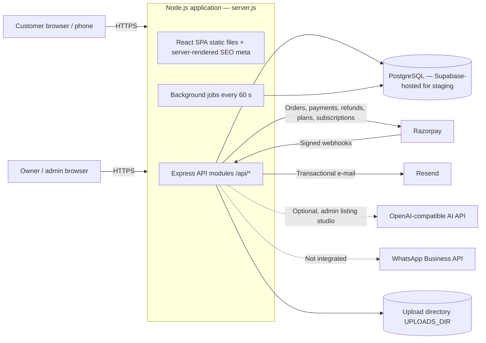
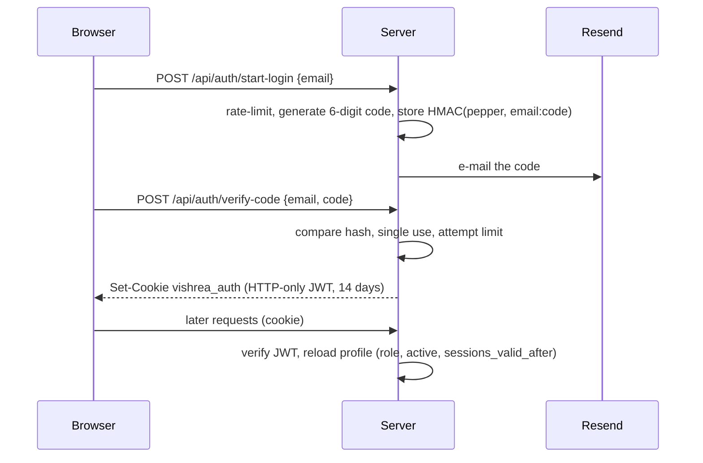
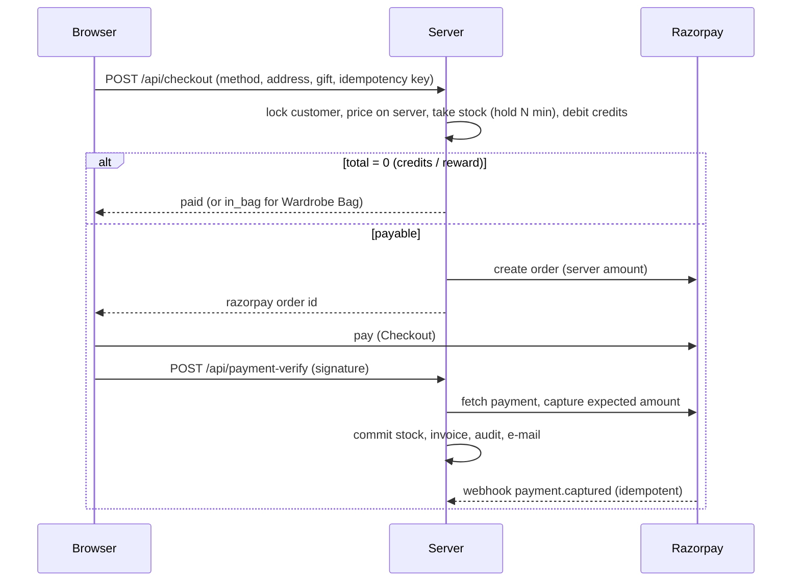
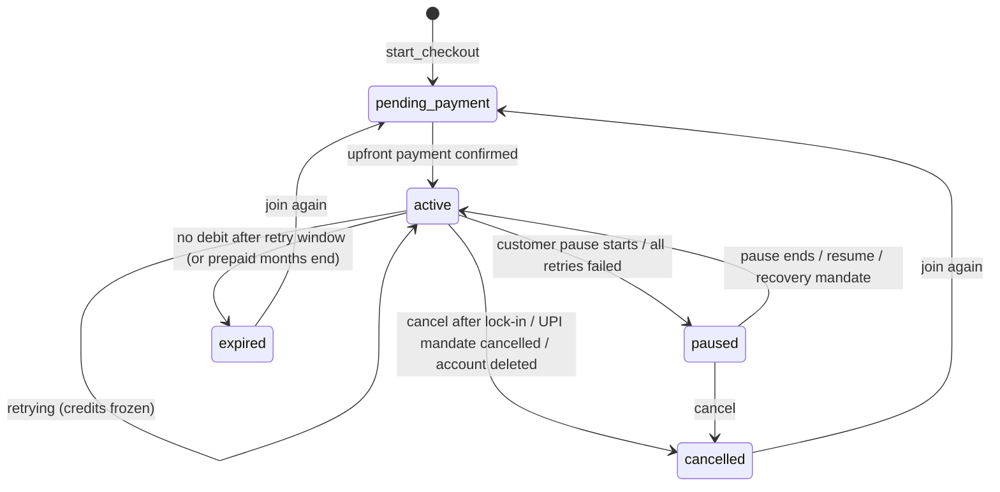

# Technical Architecture

| Field | Value |
|---|---|
| Document ID | VS-ARC-001 |
| Document title | Technical Architecture |
| Version | 1.0 |
| Status | Current — describes the code as of 7 Nov 2026 |
| Prepared date | 7 November 2026 |
| Last updated | 7 November 2026 |
| Source of truth | `server.js`, `api/`, `lib/`, `migrations/`, `vishrea-react/` |

Related: [Database Schema](DATABASE_SCHEMA.md) · [API Documentation](API_DOCUMENTATION.md) · [Security Audit](SECURITY_AUDIT.md)

> Where this differs from older documents (`../archive/SYSTEM_FLOW_AND_CHECKLIST.md`, the V1 Proposal's Supabase Auth/Storage and Vercel assumptions), this document describes what the code actually does.

## 1. System context



- **One deployable**: a long-running Node.js process (`server.js`) serving the built React app (`vishrea-react/dist`), the REST API, uploads and background jobs.
- **Database**: PostgreSQL through the `pg` driver (`lib/db.js`, pooled, statement timeout). Supabase is used only as a PostgreSQL host; Supabase Auth, Storage and PostgREST are not used (and are locked out by migration 013).
- **No client-side secrets**: the browser only receives the Razorpay key id.

## 2. Front end — `vishrea-react/`

| Item | Detail |
|---|---|
| Stack | React 19, React Router 7, Vite 8, plain CSS (`src/index.css`), `lucide-react` icons |
| State | `src/context/StoreContext.jsx` (session, bag, referral capture); `src/lib/useApi.js` data hooks |
| Pages | Home, Catalogue, ProductDetail, Cart, Checkout, Orders, OrderDetail, Account, Membership, Wardrobe (Wardrobe Bag), Gifting, GiftRedeem, SkinToneAnalysis, Login, Contact, legal pages, Admin + AdminExtras |
| Payments | `src/lib/payments.js` `openRazorpay` — order checkout (`order_id`) or mandate checkout (`subscription_id`, `recurring`) |
| Colour analysis | `src/lib/colourEngine.js` — Canvas sampling + CIELAB, 12 sub-seasons; runs entirely in the browser |
| SEO | Server injects titles, canonical URLs, JSON-LD (Product, FAQPage) via `lib/seo.js` |
| Lint | `oxlint` (`npm run lint`) |

## 3. Back end — `server.js`, `api/`, `lib/`

Request pipeline (in order): request id → HTTPS redirect → security headers → CORS (`/api`) → cookies → global rate limit → **Razorpay webhook router (raw body)** → origin guard (CSRF) → session lookup → upload router → JSON parser → `/api/health` → `/api/auth` → domain modules → 404 → SPA/static → error handler.

Domain modules are mounted from `API_MODULES`; each exports `access`, `methods` and optional `rateLimitPerUser`, enforced centrally by `mountModule`.

| Library module | Responsibility |
|---|---|
| `lib/auth.js` | OTP generation/hash, JWT session, admin role + allow-list |
| `lib/http.js` | Errors, security headers, HTTPS redirect, origin guard |
| `lib/validate.js` | Input validation helpers (text, int, money, uuid, phone, GSTIN, state …) |
| `lib/settings.js`, `lib/settings-admin.js` | Typed owner settings (`SETTING_META`), cache, validation, audited save |
| `lib/pricing.js` | Product price, per-piece GST slab, cart totals, shipping, Wardrobe Bag fee, membership price |
| `lib/cart.js`, `lib/inventory.js` | Cart lines with server data and issues (incl. early access), stock take/reserve/release/commit, expiry sweep |
| `lib/payments.js` | Order finalisation, invoices, refunds, reconciliation, membership payment finalisation |
| `lib/billing.js` | Membership billing engine: mandates, upfront and monthly debits, retries, halt, recovery, pause/resume/cancel, billing jobs |
| `lib/membership.js` | Paid months (`membership_periods`), credit grants, 8-credit limit, consecutive-month count, 6th-month reward, expiry |
| `lib/credits.js` | Credit ledger FIFO spend/expiry reconciliation |
| `lib/referrals.js`, `lib/rewards.js` | Referral codes/attribution/discount/qualification; free-piece eligibility |
| `lib/gifts.js`, `lib/bag.js` | Gift enquiries, online gift purchases, one-time codes; Wardrobe Bag shipments |
| `lib/catalogue.js`, `lib/seo.js` | Public product queries, drop visibility, SEO rendering |
| `lib/notify.js` | Notification service (templates, preferences, consent, de-dupe, log); e-mail via Resend |
| `lib/razorpay.js` | Razorpay REST client and signature checks |
| `lib/audit.js`, `lib/log.js` | Audit trail; structured JSON logs with secret scrubbing |
| `lib/uploads.js`, `lib/ai.js` | Upload storage/validation; AI provider adapter |

### Background jobs (`startBackgroundJobs`, every 60 s, no overlap)

1. `sweepExpiredOrders` — release expired stock holds.
2. `reconcilePayments` — recheck unconfirmed payments, retry refunds.
3. `runMembershipLifecycle` — grant credits for months that have started, expire lapsed memberships.
4. `runBillingJobs` — start/end customer pauses, resume/cancel mandates, re-sync overdue mandates with Razorpay, reminders (debit in 3 days, credits expiring in 10 days, gift ending), reward announcements.
5. `expireBagShipments` — close unpaid Wardrobe Bag shipment requests.
6. `cleanOrphanUploads` — optional.

## 4. Authentication



Admin = profile role `admin`/`owner` (or `is_admin`) **and**, when `ADMIN_ALLOWED_EMAILS` is set, an allow-listed e-mail. No two-step verification yet (see Security Audit S-01).

## 5. Order and payment flow



Late payments after a hold expired re-acquire stock or are refunded automatically; a second capture is refunded once.

## 6. Membership billing flow (MEM-01, MEM-07)

```mermaid
sequenceDiagram
  participant B as Browser
  participant S as Server
  participant R as Razorpay
  B->>S: start_checkout {months: 2}
  S->>R: ensure plan ₹1,799/month; create subscription (start_at = +2 months, add-on ₹3,598 or ₹3,448 with referral)
  S-->>B: subscription_id
  B->>R: authorise UPI Autopay + pay add-on
  B->>S: activate_paid (payment_id, subscription_id, signature)
  S->>R: fetch payment + subscription (amount, status)
  S->>S: append 2 paid months, grant 4 credits now, invoice, referral reward, lock-in until +2 months
  Note over S: Month 2 starts → job grants 4 more credits (no charge)
  R-->>S: subscription.charged (month 3, ₹1,799)
  S->>S: append 1 month at paid_through, grant 4 credits (≤ 8 held), invoice
  R-->>S: subscription.pending (debit failed)
  S->>S: billing_status = retrying → credits frozen, reminder
  R-->>S: subscription.halted (all retries failed)
  S->>S: membership paused (payment_failed), loyalty count reset
  B->>S: recover → new mandate, first month charged, old mandate cancelled
```

### Membership states



`memberships.status` (membership), `billing_status` (`prepaid`, `pending_authorisation`, `active`, `retrying`, `halted`, `cancelled`, `completed`) and the frozen-credit rule (`creditsUsable`) are kept separate.

## 7. Integrations

| Integration | Purpose | Configuration | State |
|---|---|---|---|
| Razorpay | Orders, capture, refunds, plans, subscriptions, invoices, webhooks | `RAZORPAY_KEY_ID`, `RAZORPAY_KEY_SECRET`, `RAZORPAY_WEBHOOK_SECRET`, optional `RAZORPAY_MEMBERSHIP_PLAN_ID` (used only if its amount matches), `RAZORPAY_API_BASE` | Implemented; Subscriptions/UPI Autopay not yet enabled on the account; no live test |
| Resend | Sign-in codes and notifications | `RESEND_API_KEY`, `EMAIL_FROM` | Implemented; delivery depends on a verified sender domain |
| OpenAI-compatible API | Listing studio text suggestions | `OPENAI_API_KEY`, `OPENAI_BASE_URL`, `AI_MODEL` | Optional; returns 502 `listing_ai_unavailable` without a key |
| WhatsApp Business API | Main customer channel (spec) | — | Not integrated; deferred in the proposal |
| Google Merchant / Meta catalogue | Catalogue sync (spec) | — | Not integrated; deferred in the proposal |

## 8. Configuration

Variables (names only; see `.env.example`): `PORT`, `NODE_ENV`, `APP_ORIGIN`, `CORS_ORIGINS`, `TRUST_PROXY`, `FORCE_HTTPS`, `CSP_MODE`, `JWT_SECRET`, `SESSION_DAYS`, `OTP_PEPPER`, `DEFAULT_ADMIN_EMAIL`, `ADMIN_ALLOWED_EMAILS`, `RESEND_API_KEY`, `EMAIL_FROM`, `AUTH_DEV_OTP_ECHO`, `DATABASE_URL`, `DATABASE_SSL`, `ALLOW_REMOTE_DATABASE`, `DATABASE_SSL_CA_FILE`, `DB_POOL_MAX`, `DB_STATEMENT_TIMEOUT_MS`, `RAZORPAY_KEY_ID`, `RAZORPAY_KEY_SECRET`, `RAZORPAY_WEBHOOK_SECRET`, `RAZORPAY_MEMBERSHIP_PLAN_ID`, `RAZORPAY_AUTO_REFUND`, `UPLOADS_DIR`, `UPLOAD_ORPHAN_CLEANUP_DAYS`, `OPENAI_API_KEY`, `OPENAI_BASE_URL`, `AI_MODEL`.

Business numbers (prices, fees, days, limits) are **settings in the database**, edited in Admin → Settings, not environment variables.

## 9. Deployment model

Not yet deployed. Requirements: Node.js ≥ 20 long-running process (background jobs), PostgreSQL, persistent storage for `UPLOADS_DIR`, HTTPS termination (set `TRUST_PROXY`), a public HTTPS URL registered as the Razorpay webhook. The proposal's Vercel assumption does not fit a long-running process with jobs and local uploads (DEC-25). Start scripts: `start.ps1` / `start.sh`.
